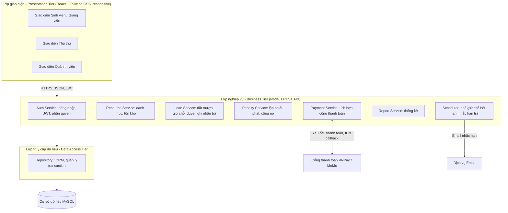
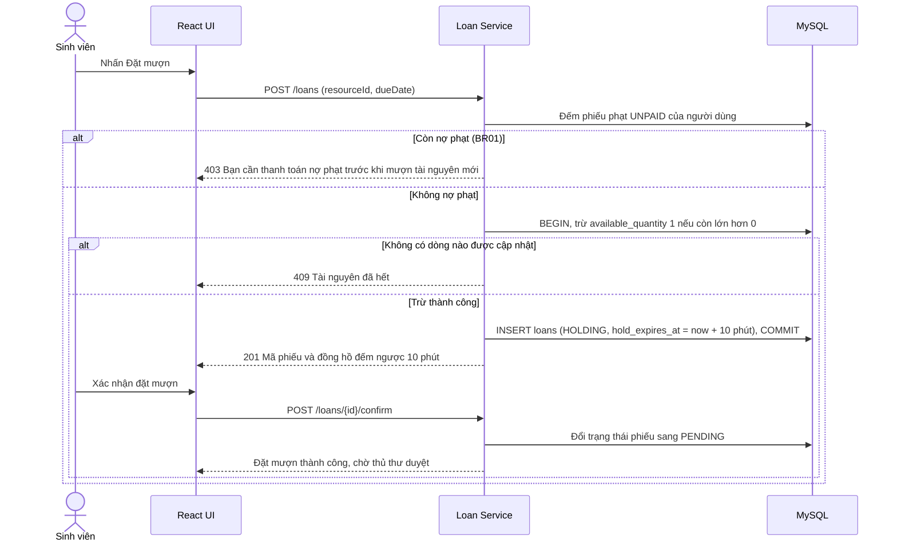
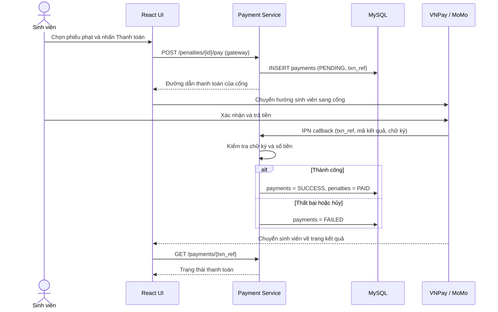
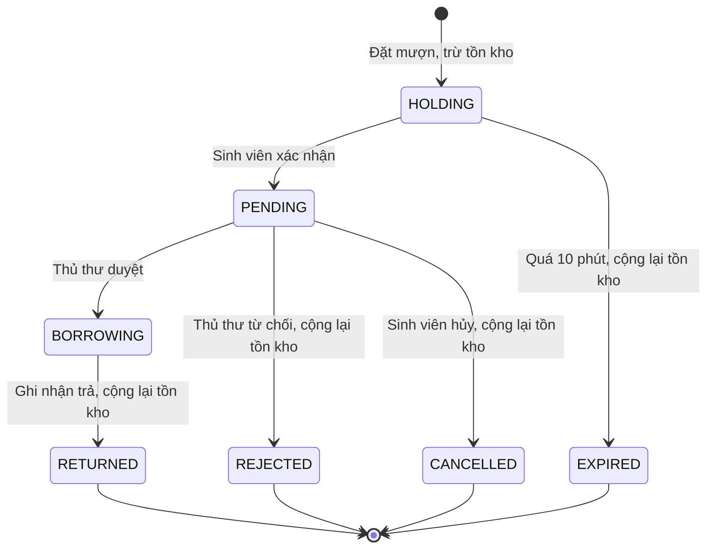

## Kiến trúc (C1,C2 và C5 - LAB 7)

## Chương 1. Tổng quan thiết kế

### 1.1. Giới thiệu bài toán

Quy trình tra cứu và mượn trả hiện nay làm thủ công: sinh viên đến thư viện mới biết sách hoặc thiết bị đã hết, còn thủ thư ghi sổ nên dễ sai sót, trùng lịch mượn, thất lạc tài sản và khó thu tiền phạt. Hệ thống số hóa toàn bộ quy trình này trên nền web.

### 1.2. Mục tiêu và phạm vi hệ thống

- Tra cứu tài nguyên (sách, thiết bị, phòng học) và xem tình trạng khả dụng theo thời gian thực.
- Đặt mượn trực tuyến, có cơ chế giữ chỗ để tránh hai người cùng mượn một tài nguyên cuối cùng (race condition).
- Thủ thư duyệt phiếu, ghi nhận trả, lập phiếu phạt; hệ thống tự cộng, trừ tồn kho và tính công nợ.
- Thanh toán tiền phạt trực tuyến qua VNPay hoặc MoMo.
- Báo cáo thống kê lượt mượn trả và vi phạm theo tháng.
- Ngoài phạm vi 10 tuần: kiosk quét thẻ NFC/Barcode, thông báo Zalo ZNS/SMS, hệ thống gợi ý tài liệu, Dark Mode (đã nêu ở hướng phát triển của Lab 3).

### 1.3. Các nhóm người dùng và chức năng chính

| Nhóm người dùng | Use case chính (Lab 2) | Giao diện sử dụng |
| --- | --- | --- |
| Sinh viên / Giảng viên | UC04 Tra cứu, UC05 Xem lịch trống, UC06 Đặt mượn, UC09 Xem lịch sử và công nợ, UC10 Thanh toán phạt | Web responsive (điện thoại và máy tính) |
| Cán bộ thư viện (Thủ thư) | UC02 Quản lý danh mục, UC07 Duyệt phiếu, UC08 Ghi nhận trả và đánh giá hư hỏng, UC11 Lập báo cáo | Web, giao diện quản lý |
| Quản trị viên (Admin) | UC03 Quản lý tài khoản và phân quyền, cấu hình tham số hệ thống | Web, giao diện quản trị |
| Hệ thống thanh toán bên ngoài (VNPay, MoMo) | Nhận yêu cầu thanh toán, trả kết quả về hệ thống | API và Webhook |

UC01 Đăng nhập / Đăng xuất dùng chung cho mọi nhóm.

### 1.4. Các giả định và quy tắc nghiệp vụ

| Mã | Quy tắc nghiệp vụ | Nguồn |
| --- | --- | --- |
| BR01 | Người dùng còn phiếu phạt chưa thanh toán thì không được đặt mượn mới. | Lab 2, UC06 |
| BR02 | Chỉ giữ chỗ và duyệt khi số lượng khả dụng lớn hơn 0. | Lab 2 |
| BR03 | Khi đặt mượn, hệ thống tạm giữ tài nguyên 10 phút để người dùng xác nhận; quá hạn tự nhả lại tồn kho. | Lab 3, Phần 5 |
| BR04 | Số lượng mượn tối đa, số ngày mượn và mức phạt mỗi ngày do Admin cấu hình, không viết cứng trong mã. | US16 |
| BR05 | Trả trễ: phạt = số ngày trễ × mức phạt mỗi ngày. Hư hỏng hoặc mất: thủ thư chọn mức độ và nhập số tiền khi lập phiếu phạt. | US13, UC3 |
| BR06 | Phiếu phạt thanh toán thành công thì tự động gỡ giới hạn mượn. | US08 |
| BR07 | Chỉ thủ thư được thêm, sửa, xóa tài nguyên, duyệt phiếu và ghi nhận trả; chỉ Admin được phân quyền tài khoản. | Lab 3, Phần 4 |
| BR08 | Chỉ tài khoản email của trường được đăng nhập. | US01 |

**Giả định của nhóm:**

- Sơ đồ lớp của Lab 5 chưa có trong tài liệu gửi kèm; Chương 3.7 dùng bộ lớp suy ra từ Lab 2 và Lab 3, nhóm đối chiếu lại khi có bản chính thức.
- Cơ sở dữ liệu là MySQL 8 (kiểu dữ liệu ở Chương 3 theo cú pháp MySQL); cổng thanh toán chạy ở môi trường sandbox.
- Nhắc hạn trả (US09) gửi qua email trong phạm vi 10 tuần.

## Chương 2. Thiết kế kiến trúc

### 2.1. Lựa chọn mô hình kiến trúc

Nhóm chọn kiến trúc 3 lớp (3-Tier): giao diện React, nghiệp vụ Node.js REST API và cơ sở dữ liệu quan hệ. Hai bên giao tiếp qua HTTPS với dữ liệu JSON, xác thực bằng JWT.

### 2.2. Sơ đồ kiến trúc tổng thể

Hình 2.1. Kiến trúc 3 lớp của hệ thống.

### 2.3. Mô tả trách nhiệm từng lớp

| Lớp | Thành phần | Trách nhiệm |
| --- | --- | --- |
| Giao diện | React, Tailwind CSS | Hiển thị và nhận thao tác của sinh viên, giảng viên, thủ thư, admin; kiểm tra dữ liệu nhập cơ bản; gọi API; hiển thị thông báo thành công hoặc lỗi; tương thích điện thoại. |
| Nghiệp vụ | Auth, Resource, Loan, Penalty, Payment, Report, Scheduler | Áp dụng quy tắc BR01 đến BR08: kiểm tra nợ phạt và tồn kho, giữ chỗ 10 phút, duyệt hoặc từ chối, tính tiền phạt, xác thực kết quả cổng thanh toán, phân quyền theo vai trò trên từng API. |
| Truy cập dữ liệu | Repository, ORM | Đọc, ghi, cập nhật dữ liệu; mở transaction cho các thao tác đổi tồn kho; không chứa quy tắc nghiệp vụ. |
| Cơ sở dữ liệu | MySQL | Lưu người dùng, tài nguyên, phiếu mượn, phiếu phạt, giao dịch thanh toán, tham số hệ thống; đảm bảo khóa ngoại, ràng buộc UNIQUE và CHECK; sao lưu tự động lúc 02:00 hằng ngày. |

### 2.4. Luồng xử lý nghiệp vụ đặt mượn tài nguyên (UC06)

Bước then chốt là trừ tồn kho bằng một câu lệnh UPDATE có điều kiện `available_quantity > 0`. Câu lệnh này chạy nguyên tử, nên hai sinh viên đặt cùng lúc tài nguyên cuối cùng thì chỉ một người thành công.

Hình 2.2. Luồng đặt mượn có giữ chỗ.

Các nhánh còn lại của phiếu mượn:

- Hết 10 phút mà sinh viên chưa xác nhận: Scheduler đổi phiếu sang EXPIRED và cộng lại 1 vào `available_quantity`.
- Sinh viên hủy phiếu PENDING (US05) hoặc thủ thư từ chối (UC07): phiếu sang CANCELLED hoặc REJECTED và cộng lại tồn kho.
- Thủ thư duyệt: phiếu sang BORROWING, tồn kho giữ nguyên vì đã trừ lúc giữ chỗ.
- Thủ thư ghi nhận trả (UC08): phiếu sang RETURNED và cộng lại 1; nếu trả trễ hoặc hư hỏng thì rẽ nhánh lập phiếu phạt.

### 2.5. Luồng xử lý học phí và thanh toán, áp dụng cho tiền phạt (UC10)

Hệ thống không có học phí; khoản phải thu là tiền phạt vi phạm. Kết quả thanh toán chỉ được tin khi cổng gọi về IPN và chữ ký hợp lệ, không dựa vào việc trình duyệt quay lại trang kết quả.

Hình 2.3. Luồng thanh toán tiền phạt.

Khi mọi phiếu phạt của sinh viên đã PAID, BR01 không còn chặn và sinh viên được đặt mượn lại (BR06).

### 2.6. Lý do lựa chọn kiến trúc

- Dễ chia việc theo vai trò đã phân công ở Lab 3: Chiến làm lớp giao diện, Khoa làm lớp nghiệp vụ và dữ liệu, Phát kiểm thử từng lớp độc lập.
- Quy tắc nghiệp vụ và transaction tập trung ở một lớp nên xử lý được race condition và công nợ nhất quán; giao diện không tự quyết định gì về tồn kho.
- Lớp nghiệp vụ không lưu trạng thái phiên (JWT) nên có thể chạy nhiều bản sau bộ cân bằng tải để đạt 500 người dùng đồng thời (NFR của Lab 3).
- Không chọn Microservices: nhóm 4 người, 10 tuần, hệ thống chỉ có 4 module; chi phí vận hành và giao dịch phân tán lớn hơn lợi ích. Các Service ở Hình 2.1 tách theo module nên có thể tách riêng về sau.

## Chương 5. Đánh giá thiết kế

### 5.1. Đối chiếu thiết kế với yêu cầu hệ thống

| Yêu cầu (Lab 2, Lab 3) | Kiến trúc | Dữ liệu | Giao diện |
| --- | --- | --- | --- |
| US01 / UC01 Đăng nhập, phân quyền | Auth Service, JWT, Bcrypt | users, roles | W1 |
| US02, US03 / UC04, UC05 Tra cứu, lịch trống | Resource Service, Loan Service | resources, categories, loans; FULLTEXT và chỉ mục lịch | W2 |
| US04, US05 / UC06 Đặt mượn, hủy | Loan Service, giữ chỗ 10 phút (Hình 2.2) | loans, resources.available_quantity | W2, W3, W4 |
| US06, US07 / UC09 Lịch sử, công nợ | Loan Service, Penalty Service | loans, penalties | W4 |
| US08 / UC10 Thanh toán phạt | Payment Service, IPN (Hình 2.3) | payments, penalties | W4 |
| US09 Nhắc hạn trả | Scheduler, dịch vụ Email | notifications | Thông báo trong hệ thống và email |
| US10 / UC02 Quản lý tài nguyên | Resource Service | resources, categories | W6 |
| US11 / UC07 Duyệt phiếu | Loan Service | loans | W5 |
| US12, US13 / UC08 Ghi nhận trả, lập phiếu phạt | Loan Service, Penalty Service | loans, penalties | W5 |
| US14 / UC11 Báo cáo | Report Service | truy vấn tổng hợp trên loans, penalties | Menu Báo cáo, chưa vẽ |
| US15, US16 / UC03 Tài khoản, tham số | Auth Service, cấu hình | users, roles, system_settings | W7 |
| NFR: tra cứu dưới 2 giây, 500 CCU | API không giữ phiên, nhân bản được; chỉ mục | FULLTEXT, các chỉ mục ở 3.5 | Phân trang danh sách |
| NFR: bảo mật, sao lưu 02:00 | JWT, phân quyền theo vai trò | password_hash Bcrypt; backup hằng ngày | Ẩn chức năng theo vai trò |

### 5.2. Kiểm tra tính nhất quán giữa kiến trúc, lớp, dữ liệu và giao diện

- Mỗi Service ở Hình 2.1 có bảng dữ liệu tương ứng ở Hình 3.1 và ít nhất một màn hình ở Chương 4, trừ Report Service chưa có wireframe.
- Vòng đời phiếu mượn dùng một bộ trạng thái duy nhất ở Hình 2.2, bảng loans và các màn hình W3, W4, W5 (xem sơ đồ trạng thái ở Phụ lục).
- Mọi quy tắc BR01 đến BR08 đều có chỗ thực thi: BR01 và BR02 ở Loan Service (Hình 2.2), BR03 ở Scheduler và `hold_expires_at`, BR04 ở system_settings và W7, BR05 ở Penalty Service và W5, BR06 ở Payment Service (Hình 2.3), BR07 ở phân quyền Auth Service, BR08 ở màn hình W1.
- Phiếu phạt trả trễ sinh ra khi ghi nhận trả (W5) và hiện ở công nợ (W4), cùng một bảng penalties.

### 5.3. Các vấn đề còn tồn tại và hướng hoàn thiện

| Vấn đề | Hướng xử lý |
| --- | --- |
| Class Diagram Buổi 5 chưa có trong tài liệu, mục 3.7 dùng lớp suy ra | Đối chiếu lại tên lớp và thuộc tính khi có bản chính thức, sửa ánh xạ nếu lệch |
| Lab 2 và Lab 3 mô tả trừ tồn kho khác nhau (trừ khi đặt, hoặc khi duyệt) | Đã chọn trừ một lần lúc giữ chỗ (mục 3.8); cần cập nhật lại UC07 trong SRS cho khớp |
| Lab 2 liệt kê UC10, UC11 viết là UC010, UC011; US05 (hủy phiếu), US09 (nhắc hạn), US13 (lập phiếu phạt) chưa có use case riêng | Sửa mã trong SRS; ghép US05 vào UC06, US13 vào UC08 hoặc thêm use case riêng |
| Mức phạt hư hỏng và mất do thủ thư tự nhập, chưa có bảng giá | Hỏi giảng viên hướng dẫn hoặc thủ thư; có thể thêm tham số tỷ lệ theo giá trị tài nguyên |
| Kiểm tra trùng phiếu và trùng lịch nằm ở tầng ứng dụng, không có ràng buộc DB | Viết test đồng thời cho luồng đặt mượn (Phát) và chạy thử 500 người dùng đồng thời |
| Nhắc hạn mới có email; Zalo ZNS, SMS để sau | Giữ ở hướng phát triển của Lab 3 |
| Wireframe chưa có màn hình báo cáo, Hồ sơ cá nhân, Phân quyền | Bổ sung ở Sprint 3 cùng Report Service |

## Kết luận

Báo cáo hoàn thiện ba phần thiết kế cho hệ thống Thư viện số và Quản lý thiết bị: kiến trúc 3 lớp với hai luồng chính (đặt mượn có giữ chỗ và thanh toán phạt), cơ sở dữ liệu 9 bảng có Data Dictionary và ràng buộc, và 7 wireframe cho ba nhóm người dùng. Thiết kế bám các use case và user story của Lab 2, Lab 3 và xử lý trực tiếp rủi ro race condition mà nhóm đã xác định. Bước tiếp theo là đối chiếu với Class Diagram Buổi 5, cập nhật SRS theo 5.3 và dựng schema cho Sprint 1.

## Tài liệu tham khảo

1. Đề cương Lab 06: Architectural & Detailed Design.
2. Báo cáo Lab 02 (52400103_TranMinhChien_LAB02): Phân tích và đặc tả yêu cầu phần mềm.
3. Báo cáo Lab 03 (52400103_TranMinhChien_LAB03): Agile Project Management & Scrum Framework.

## Phụ lục

- Sơ đồ kiến trúc tổng thể: Hình 2.1.
- Sơ đồ ERD: Hình 3.1 trong [database.md](database.md).
- Data Dictionary: mục 3.4 trong [database.md](database.md).
- Bộ UI Wireframes: mục 4.2 đến 4.6 (W1 đến W7) trong [ui-design.md](ui-design.md).
- Sơ đồ bổ sung: Hình 2.2 (luồng đặt mượn), Hình 2.3 (luồng thanh toán) và sơ đồ trạng thái phiếu mượn dưới đây.

Hình P.1. Sơ đồ trạng thái của phiếu mượn (loans.status).

