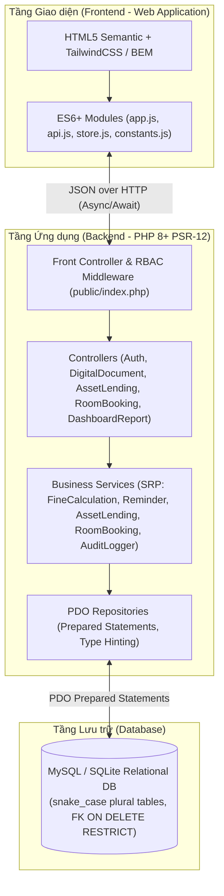

# Kiến trúc Hệ thống Thư viện Số & Cho mượn Tài sản Đại học

## 1. Tổng quan Kiến trúc (System Overview)

**Hệ thống Thư viện Số & Cho mượn Tài sản Đại học (University Digital Library & Asset Lending Platform)** được thiết kế theo kiến trúc phân tầng (Layered Architecture) kết hợp mô hình RESTful API giữa **Frontend** (HTML5 ngữ nghĩa, CSS BEM/Tailwind, ES6+ JavaScript) và **Backend** (PHP 8+ chuẩn PSR-12, PDO Prepared Statements, Strict Type Hinting), đảm bảo tuân thủ 3 nguyên lý Clean Code cốt lõi:
- **Single Responsibility Principle (SRP)**: Tách biệt hoàn toàn tầng điều hướng HTTP (`Controllers`), tầng xử lý nghiệp vụ thuần túy (`Services`), và tầng truy xuất dữ liệu (`Repositories`).
- **No Magic Numbers**: Toàn bộ các hằng số cấu hình nghiệp vụ (số ngày mượn tối đa, đơn giá phạt, ngưỡng khóa tài khoản, thời gian hủy phòng tối thiểu, mã trạng thái, mã vai trò) được quản lý tập trung tại `AppConstants` (Backend) và `constants.js` (Frontend).
- **Defensive Copying**: Các đối tượng dữ liệu và danh sách trả về từ tầng Model/Repository/Store luôn được sao chép phòng vệ (`clone` hoặc Spread Operator `[...]`) nhằm ngăn chặn việc thay đổi trạng thái ngoài ý muốn.

---

## 2. Sơ đồ Kiến trúc Phân tầng (Layered Architecture)

---

## 3. Phân quyền theo Vai trò (Role-Based Access Control - RBAC)

Hệ thống phân định 4 nhóm tác tử (Actors) với phạm vi quyền hạn chặt chẽ:

| Vai trò (Actor) | Mã Vai trò (`role_id`) | Quyền hạn & Chức năng chính |
| :--- | :---: | :--- |
| **Quản trị viên (Admin / Manager)** | `1` (`ROLE_ADMIN`) | Cài đặt danh mục tài nguyên, thời gian mượn tối đa, mức phí phạt; xem Dashboard thống kê (F-09), xuất báo cáo định kỳ (F-10); giám sát Nhật ký Kiểm toán (Audit Trail - F-12). |
| **Cán bộ Thư viện (Librarian)** | `2` (`ROLE_LIBRARIAN`) | Quản lý kho tài liệu số (F-01) và tài sản vật lý; quét mã QR xác nhận bàn giao & nhận trả tài sản (F-04); ghi nhận hư hỏng; kích hoạt/theo dõi cảnh báo trễ hạn (F-05, F-06). |
| **Giảng viên (Lecturer)** | `3` (`ROLE_LECTURER`) | Tất cả quyền của Sinh viên; được miễn phí hoàn toàn chi phí đặt phòng/thiết bị (`calculateBookingCost = 0`); đề xuất bổ sung tài liệu mới; xem thống kê sử dụng học liệu của lớp phụ trách. |
| **Sinh viên (Student)** | `4` (`ROLE_STUDENT`) | Tra cứu & đọc tài liệu số trực tuyến (F-01, F-02); đặt mượn thiết bị/sách in (F-03); đặt phòng học theo khung giờ (F-07, F-08); theo dõi lịch sử mượn, công nợ và nhận thông báo nhắc trả (F-05). |

---

## 4. Đặc tả 6 Phân hệ Chức năng (F-01 đến F-12)

1. **Phân hệ 1 - Quản lý Kho Tài liệu Số (`DigitalLibraryService`)**:
   - **F-01**: Kiểm tra trùng mã ISBN trước khi thêm mới; tự động gợi ý phân loại khung thập phân Dewey (000–900); tìm kiếm đa tiêu chí (từ khóa, tác giả, thể loại, năm xuất bản).
   - **F-02**: Trình đọc tài liệu trực tuyến tích hợp (`Online Reader`), ghi nhận trang đang đọc, thời lượng đọc và kiểm soát giới hạn số trang in tối đa (`MAX_PRINT_PAGES_PER_SESSION`).
2. **Phân hệ 2 - Đăng ký Mượn & Trả Tài sản Vật lý (`AssetLendingService`)**:
   - **F-03**: Kiểm tra trạng thái tài sản (`AVAILABLE`), kiểm tra tài khoản không bị khóa công nợ, sinh phiếu mượn điện tử kèm mã định danh QR duy nhất.
   - **F-04**: Quét mã QR tại quầy thư viện để chuyển trạng thái từ `RESERVED` sang `BORROWED` (khi nhận) và từ `BORROWED` sang `RETURNED` (khi trả), đồng thời cập nhật tình trạng vật lý của thiết bị.
3. **Phân hệ 3 - Động cơ Nhắc nhở & Tính Phí Phạt Tự động (`ReminderService` & `FineCalculationService`)**:
   - **F-05**: Quét tự động các phiếu mượn sắp đến hạn (còn đúng 3 ngày hoặc 1 ngày) để phát thông báo nhắc trả qua Email và Notification Center.
   - **F-06**: Tính phí phạt trễ hạn theo công thức `Số ngày trễ × Đơn giá phạt theo loại tài sản`, cộng dồn vào hồ sơ công nợ của người dùng và tự động khóa quyền mượn (`STATUS_LOCKED`) nếu tổng nợ vượt ngưỡng `DEBT_LOCK_THRESHOLD` (100,000 VNĐ).
4. **Phân hệ 4 - Đặt Phòng Học & Không gian Thảo luận (`RoomBookingService`)**:
   - **F-07**: Kiểm tra xung đột khung giờ theo thời gian thực (`start_time < existing_end AND end_time > existing_start`), hiển thị lịch trống dạng bảng tuần.
   - **F-08**: Cho phép hủy hoặc dời lịch trước giờ bắt đầu tối thiểu 2 giờ (`MIN_CANCEL_HOURS_BEFORE = 2`) mà không bị phạt, giải phóng ngay lập tức slot phòng.
5. **Phân hệ 5 - Bảng Tổng quan & Báo cáo Thống kê (`ReportExportService`)**:
   - **F-09**: Tổng hợp thời gian thực tỷ lệ tài sản đang mượn, Top 10 tài liệu số đọc nhiều nhất, và xu hướng mượn/đọc theo tháng.
   - **F-10**: Xuất dữ liệu báo cáo sử dụng tài sản và danh sách công nợ ra định dạng CSV/Excel và bản in PDF.
6. **Phân hệ 6 - Bảo mật & Nhật ký Kiểm toán (`AuthService` & `AuditLoggerService`)**:
   - **F-11**: Xác thực mật khẩu băm chuẩn `bcrypt` (`PASSWORD_BCRYPT`), hỗ trợ mô phỏng đăng nhập SSO nhà trường và kiểm tra phân quyền RBAC trên mọi endpoint.
   - **F-12**: Lưu vết bất biến (Immutable Audit Trail) cho mọi thao tác quan trọng (đăng nhập, thêm tài liệu, đặt mượn, quét QR nhận/trả, tính phạt, đặt/hủy phòng).
