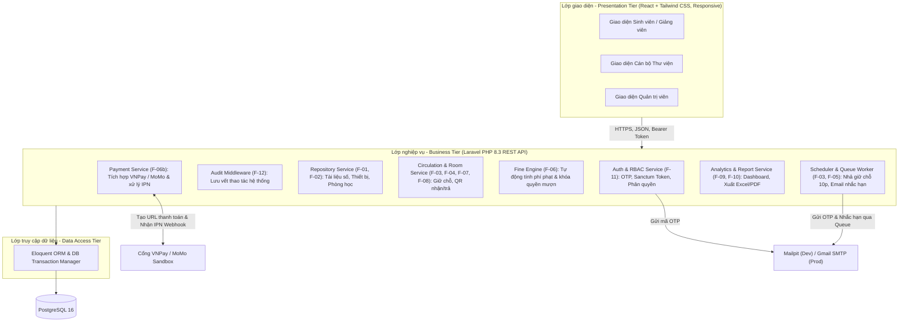
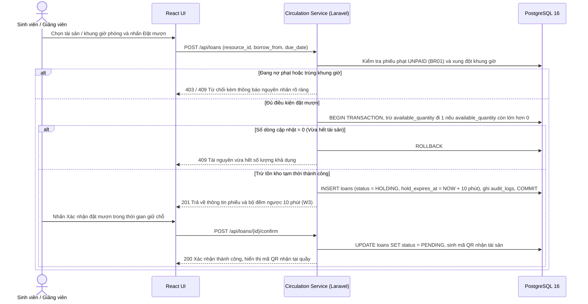
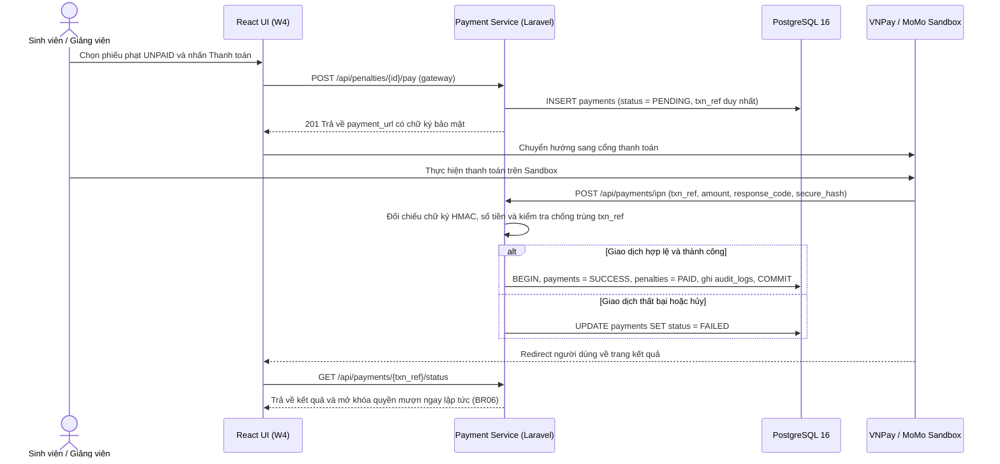
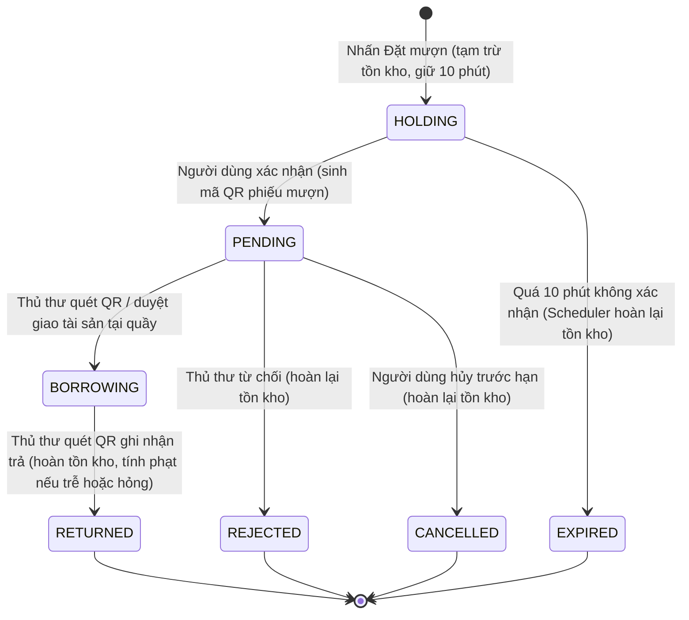

# Tài liệu Thiết kế Kiến trúc Hệ thống

## Chương 1. Tổng quan thiết kế

### 1.1. Giới thiệu bài toán

Trong môi trường đại học, quy trình tra cứu và mượn trả học liệu, thiết bị hiện vẫn còn phân mảnh và thủ công: sinh viên, giảng viên mất thời gian đến tận quầy mới biết sách hoặc thiết bị đã hết; cán bộ thư viện ghi chép sổ sách dễ dẫn đến sai sót, trùng lịch đặt phòng, thất lạc tài sản và khó theo dõi công nợ phí phạt. **Hệ thống Thư viện Số & Cho mượn Tài sản Đại học** số hóa toàn diện quy trình trên nền tảng Web, quản lý tập trung 3 nhóm tài nguyên: **Tài liệu số (PDF/EPUB)**, **Tài sản vật lý (Sách in, Thiết bị)** và **Phòng học / Không gian thảo luận**.

### 1.2. Mục tiêu và phạm vi hệ thống

Hệ thống hiện thực hóa đầy đủ 6 phân hệ chức năng (`F-01` đến `F-12`) theo đặc tả đề tài và mở rộng thêm cổng thanh toán trực tuyến (`F-06b`):

- **Kho tài liệu số (`F-01`, `F-02`):** Quản lý danh mục học liệu điện tử, tra cứu đa tiêu chí dưới 2 giây và tích hợp trình đọc PDF trực tuyến (*Online Reader*) ngay trên trình duyệt.
- **Mượn trả tài sản vật lý & Đặt phòng học (`F-03`, `F-04`, `F-07`, `F-08`):** Xem lịch trống theo khung giờ thực tế, đặt mượn trực tuyến có cơ chế **giữ chỗ tạm thời 10 phút** chống tranh chấp (*race condition*), sinh mã QR phiếu mượn để xác nhận giao/nhận tại quầy và cho phép hủy lịch trước hạn.
- **Nhắc hạn, Tính phạt tự động & Thanh toán điện tử (`F-05`, `F-06`, `F-06b`):** Tự động gửi email nhắc hạn trả (trước 3 ngày và 1 ngày), tự động tính phí phạt trễ hạn, khóa quyền mượn khi có nợ phạt và tích hợp thanh toán qua **VNPay / MoMo Sandbox** để tự động gỡ khóa.
- **Thống kê & Kiểm toán bảo mật (`F-09`, `F-10`, `F-11`, `F-12`):** Xác thực không mật khẩu bằng mã OTP qua email trường, phân quyền chặt chẽ 4 vai trò (RBAC), lưu vết toàn bộ thao tác nhạy cảm vào Nhật ký kiểm toán (*Audit Log*) và xuất báo cáo định kỳ ra Excel/PDF.
- **Ngoài phạm vi 10 tuần (Hướng phát triển):** Kiosk phần cứng quét thẻ từ NFC tự phục vụ không cần thủ thư, thông báo qua Zalo ZNS/SMS Gateway và hệ thống gợi ý học liệu bằng AI.

### 1.3. Các nhóm người dùng và phân hệ chức năng

| Tác tử (Vai trò) | Mã chức năng phụ trách / sử dụng | Giao diện sử dụng |
| --- | --- | --- |
| **Sinh viên (Student)** | `F-01` Tra cứu, `F-02` Đọc tài liệu số, `F-03` Đặt mượn tài sản, `F-05` Nhận nhắc hạn, `F-06` Xem công nợ, `F-06b` Thanh toán phạt, `F-07` Đặt phòng học, `F-08` Hủy lịch đặt | Web responsive (điện thoại và máy tính) |
| **Giảng viên (Lecturer)** | Toàn bộ quyền của Sinh viên; bổ sung quyền đề xuất tài liệu mới (`F-01`) và xem thống kê sử dụng học liệu lớp phụ trách (`F-09`) | Web responsive (điện thoại và máy tính) |
| **Cán bộ thư viện (Librarian)** | `F-01` Quản lý kho tài liệu số & tài sản, `F-04` Quét QR / duyệt xuất kho & ghi nhận trả, `F-06` Ghi nhận hư hỏng / lập phiếu phạt, `F-09` & `F-10` Xem và xuất báo cáo | Web, giao diện nghiệp vụ quầy |
| **Quản trị viên (Admin)** | `F-11` Quản lý tài khoản & phân quyền 4 vai trò, cấu hình tham số hệ thống, `F-09` Dashboard tổng quan, `F-12` Giám sát Audit Log | Web, giao diện quản trị hệ thống |
| **Cổng thanh toán (VNPay, MoMo)** | `F-06b` Tiếp nhận yêu cầu thanh toán phí phạt và gọi ngược IPN Webhook xác nhận kết quả | REST API & IPN Webhook |

*(Chức năng `F-11: Đăng nhập OTP qua email trường & Đăng xuất` áp dụng chung cho cả 4 vai trò nội bộ).*

### 1.4. Các giả định và quy tắc nghiệp vụ

| Mã | Quy tắc nghiệp vụ | Phân hệ áp dụng |
| --- | --- | --- |
| **BR01** | Người dùng đang có phiếu phạt chưa thanh toán (`UNPAID`) thì bị khóa quyền đặt mượn mới và đặt phòng. | `F-03`, `F-06`, `F-07` |
| **BR02** | Chỉ cho phép tạo giữ chỗ và duyệt mượn khi số lượng khả dụng (`available_quantity`) lớn hơn 0 và không trùng khung giờ đặt trước. | `F-03`, `F-07` |
| **BR03** | Khi nhấn Đặt mượn, hệ thống tạm trừ tồn kho và giữ chỗ trong **10 phút** (`HOLDING`) để người dùng xác nhận; quá 10 phút tự động chuyển `EXPIRED` và hoàn lại tồn kho. | `F-03`, `F-07` |
| **BR04** | Hạn mức mượn tối đa, thời gian mượn, thời gian hủy phòng trước hạn (mặc định 2 giờ) và đơn giá phạt mỗi ngày do Admin cấu hình động trong `system_settings`. | `F-06`, `F-08`, `F-11` |
| **BR05** | Trả trễ hạn: `Tiền phạt = Số ngày trễ × Đơn giá phạt/ngày`. Tài sản hư hỏng hoặc mất: Thủ thư chọn tình trạng khi nhận trả và nhập mức bồi thường thực tế. | `F-04`, `F-06` |
| **BR06** | Ngay khi cổng thanh toán gọi IPN xác nhận giao dịch thành công (`SUCCESS`), phiếu phạt chuyển sang `PAID` và hệ thống tự động mở lại quyền mượn. | `F-06b` |
| **BR07** | Phân quyền RBAC: Chỉ Thủ thư được CRUD tài nguyên và duyệt nhận/trả; chỉ Admin được cấp quyền tài khoản, sửa tham số hệ thống và xem Audit Log. | `F-11`, `F-12` |
| **BR08** | Chỉ email thuộc tên miền nhà trường đang ở trạng thái `ACTIVE` mới được nhận mã OTP đăng nhập; mã OTP băm một chiều, hiệu lực 5 phút, tối đa 5 lần nhập sai. | `F-11` |

---

## Chương 2. Thiết kế kiến trúc

### 2.1. Lựa chọn mô hình kiến trúc

Hệ thống áp dụng **Kiến trúc phân tầng 3 lớp (3-Tier Architecture)** đóng gói đồng bộ qua Docker Compose:
- **Presentation Tier:** Single Page Application viết bằng **React (Vite) + Tailwind CSS**.
- **Business Logic Tier:** RESTful API viết bằng **Laravel (PHP 8.3)**, xác thực phi trạng thái qua **Laravel Sanctum** (Bearer Token), xử lý tác vụ nền bằng **Laravel Scheduler & Queue**.
- **Data Tier:** Hệ quản trị cơ sở dữ liệu quan hệ **PostgreSQL 16**.

### 2.2. Sơ đồ kiến trúc tổng thể

*Hình 2.1. Sơ đồ kiến trúc 3 lớp của Hệ thống Thư viện Số & Cho mượn Tài sản Đại học.*

### 2.3. Mô tả trách nhiệm từng lớp

| Lớp | Thành phần kỹ thuật | Trách nhiệm chính |
| --- | --- | --- |
| **Giao diện (Presentation)** | React, Tailwind CSS, React Router, Axios | Hiển thị giao diện theo 4 vai trò; gắn nhãn màu trạng thái tài sản trực quan (Xanh: Còn trống, Đỏ: Đang mượn, Xám: Bảo trì); nhúng trình đọc PDF (`F-02`) và hiển thị mã QR phiếu mượn (`F-04`). |
| **Nghiệp vụ (Business)** | Laravel Controllers, Services, FormRequests, Sanctum, Queue, Scheduler | Thực thi quy tắc `BR01`–`BR08`: xác thực OTP, kiểm tra công nợ & xung đột lịch phòng, khóa giữ chỗ 10 phút, tính phí phạt trễ hạn, đối soát chữ ký HMAC từ VNPay/MoMo và ghi `audit_logs`. |
| **Truy cập dữ liệu (Data Access)** | Laravel Eloquent ORM, Database Transactions | Thực thi truy vấn an toàn qua Prepared Statements, quản lý Transaction nguyên tử (`DB::transaction`) khi thay đổi tồn kho, tách biệt hoàn toàn câu lệnh SQL khỏi tầng giao diện. |
| **Cơ sở dữ liệu (Database)** | PostgreSQL 16 | Lưu trữ bền vững 11 bảng dữ liệu; đảm bảo toàn vẹn khóa ngoại (`ON DELETE RESTRICT`), ràng buộc `CHECK`, chỉ mục tìm kiếm toàn văn `GIN` và tự động sao lưu lúc `02:00` sáng hằng ngày. |

### 2.4. Luồng xử lý đặt mượn giữ chỗ 10 phút và xác nhận QR (`F-03`, `F-04`, `F-07`)

Điểm cốt lõi để triệt tiêu *race condition* khi nhiều người cùng đặt thiết bị hoặc phòng học cuối cùng là thực thi câu lệnh cập nhật nguyên tử có điều kiện `UPDATE resources SET available_quantity = available_quantity - 1 WHERE resource_id = :id AND available_quantity > 0` ngay bên trong Transaction của PostgreSQL.

*Hình 2.2. Luồng đặt mượn có khóa giữ chỗ 10 phút chống tranh chấp đồng thời.*

**Vòng đời tiếp theo của phiếu mượn:**
- **Quá 10 phút không xác nhận:** Laravel Scheduler quét mỗi phút, chuyển các phiếu `HOLDING` quá hạn sang `EXPIRED` và cộng trả `1` vào `available_quantity`.
- **Hủy lịch đặt (`F-08`):** Người dùng hủy phiếu `PENDING` (trước giờ nhận tối thiểu 2 giờ đối với phòng học) hoặc Thủ thư từ chối $\rightarrow$ chuyển sang `CANCELLED` / `REJECTED` và hoàn lại tồn kho.
- **Nhận & Trả tại quầy (`F-04`):** Thủ thư quét mã QR (hoặc nhập mã phiếu trên `W5`) để chuyển sang `BORROWING` (khi giao đồ) và `RETURNED` (khi nhận lại đồ, cộng lại `available_quantity`). Nếu quá `due_date` hoặc tài sản hư hỏng, hệ thống tự động gọi `Fine Engine` sinh phiếu phạt (`F-06`).

### 2.5. Luồng thanh toán phí phạt trực tuyến qua VNPay / MoMo (`F-06b`)

Trạng thái công nợ chỉ được cập nhật khi nhận được **IPN Webhook** hợp lệ trực tiếp từ máy chủ cổng thanh toán kèm chữ ký điện tử (HMAC-SHA512 / SHA256) chính xác, tuyệt đối không tin tưởng tham số truyền trên URL trình duyệt của người dùng.

*Hình 2.3. Luồng thanh toán phí phạt và tự động gỡ khóa quyền mượn.*

### 2.6. Lý do lựa chọn kiến trúc

- **Phù hợp với mô hình làm việc Full-stack theo phân hệ:** Các Service nghiệp vụ (`Auth`, `Repository`, `Circulation`, `Fine`, `Payment`, `Report`) tách biệt rõ ràng giúp 4 thành viên phát triển độc lập từng cụm chức năng từ DB, API đến UI mà không gây xung đột mã nguồn (Merge Conflict).
- **Đảm bảo tính toàn vẹn nghiệp vụ cao:** Toàn bộ logic giữ chỗ, kiểm tra lịch phòng và tính tiền phạt nằm trong Transaction của Laravel & PostgreSQL 16, ngăn chặn triệt để tình trạng âm kho.
- **Khả năng mở rộng chịu tải tốt:** Xác thực qua Bearer Token của Sanctum và tách hàng đợi gửi email qua Laravel Queue giúp thời gian phản hồi API đặt mượn luôn dưới 3 giây và chịu tải tốt 500 người dùng đồng thời.
- **Tinh gọn hơn Microservices:** Trong thời lượng 10 tuần với quy mô nhóm 4 thành viên, kiến trúc Modular Monolith 3 lớp trên Docker giúp triển khai nhanh, dễ kiểm thử tích hợp và không tốn chi phí quản lý giao dịch phân tán.

---

## Chương 5. Đánh giá thiết kế

### 5.1. Ma trận truy vết Thiết kế theo Chức năng Đề tài (`F-01` → `F-12`)

| Mã CN | Chức năng theo đặc tả đề tài | Tầng Nghiệp vụ (Laravel) | Bảng CSDL (PostgreSQL) | Màn hình UI |
| --- | --- | --- | --- | --- |
| **F-01** | Quản lý Danh mục Tài liệu số & Tài sản | `RepositoryService` | `categories`, `resources` | `W2`, `W6` |
| **F-02** | Đọc tài liệu trực tuyến (*Online Reader*) | `RepositoryService` (Stream PDF) | `resources` (`file_url`) | `W2` (Modal đọc file) |
| **F-03** | Đặt mượn Thiết bị / Sách in (Giữ chỗ 10p) | `CirculationService`, `Scheduler` | `loans`, `resources` | `W2`, `W3` |
| **F-04** | Xác nhận Nhận & Trả tài sản (Mã QR) | `CirculationService` | `loans`, `resources` | `W3` (QR), `W5` (Quầy) |
| **F-05** | Gửi Nhắc hạn trả tự động (3 ngày & 1 ngày) | `Scheduler`, `Queue`, Mailer | `notifications`, `loans` | Chuông thông báo & Email |
| **F-06** | Tính phí phạt trễ hạn & Khóa quyền mượn | `FineService` | `penalties`, `system_settings` | `W4`, `W5` |
| **F-06b** | Thanh toán phí phạt qua VNPay / MoMo | `PaymentService` (IPN Webhook) | `payments`, `penalties` | `W4` |
| **F-07** | Đặt Phòng học theo khung giờ | `CirculationService` | `loans`, `resources` (`ROOM`) | `W2` (Lịch tuần), `W3` |
| **F-08** | Quản lý Hủy & Điều chỉnh lịch đặt | `CirculationService` | `loans`, `audit_logs` | `W3`, `W4` |
| **F-09** | Dashboard thống kê thời gian thực | `ReportService` | Truy vấn tổng hợp `loans`, `penalties` | `W6` / Menu Báo cáo |
| **F-10** | Xuất Báo cáo định kỳ (Excel / PDF) | `ReportService` | `loans`, `resources`, `penalties` | Menu Báo cáo |
| **F-11** | Xác thực OTP Email trường & Phân quyền | `AuthService`, Sanctum, Middleware | `users`, `roles`, `login_otps`, `system_settings` | `W1`, `W7` |
| **F-12** | Nhật ký lưu vết kiểm toán (*Audit Trail*) | `AuditLogMiddleware` | `audit_logs` | `W7` (Tab Nhật ký) |

### 5.2. Kiểm tra tính nhất quán giữa Kiến trúc, Dữ liệu và Giao diện

- **Nhất quán vòng đời phiếu mượn:** Mọi thành phần từ `CirculationService`, bảng `loans.status` đến giao diện `W3`, `W4`, `W5` đều tuân thủ duy nhất một sơ đồ trạng thái gồm 7 trạng thái (`HOLDING`, `PENDING`, `BORROWING`, `RETURNED`, `REJECTED`, `CANCELLED`, `EXPIRED`).
- **Nhất quán tiêu chí phi chức năng:**
  - *Tốc độ tra cứu $< 2\text{s}$:* Đáp ứng nhờ chỉ mục toàn văn `GIN` của PostgreSQL 16 trên bảng `resources` kết hợp phân trang API.
  - *Chống đặt trùng tuyệt đối:* Kết hợp khóa dòng nguyên tử khi trừ `available_quantity`, kiểm tra giao thoa khung giờ `(borrow_from, due_date)` và ràng buộc `Partial Unique Index` dưới tầng PostgreSQL.
  - *Bảo mật & Minh bạch:* Mã OTP được băm Bcrypt trong `login_otps`; mọi hành động đăng nhập, đặt mượn, duyệt, trả, hủy và cấu hình đều được tự động ghi vào `audit_logs`.

### 5.3. Các rủi ro kỹ thuật và phương án kiểm soát

| Vấn đề kỹ thuật | Giải pháp kiểm soát đã thiết kế |
| --- | --- |
| Nhiều người dùng cùng đặt thiết bị / phòng học cuối cùng tại cùng một thời điểm | Trừ tồn kho bằng câu lệnh `UPDATE ... WHERE available_quantity > 0` trong Transaction + viết kịch bản kiểm thử đồng thời (Concurrency Test) và thử tải 500 CCU. |
| Cổng thanh toán gọi lặp IPN nhiều lần gây cập nhật trùng giao dịch | Ràng buộc `UNIQUE` trên cột `payments.txn_ref` và kiểm tra trạng thái `status != 'SUCCESS'` trong Transaction trước khi đổi trạng thái phiếu phạt. |
| Gửi email OTP và email nhắc hạn hàng loạt làm chậm tốc độ phản hồi API | Đẩy toàn bộ tác vụ gửi mail vào **Laravel Queue** chạy nền; môi trường phát triển dùng **Mailpit** nội bộ để không bị giới hạn hạn ngạch SMTP. |
| Xóa nhầm tài sản hoặc tài khoản làm gãy lịch sử mượn trả và kiểm toán | Áp dụng khóa ngoại `ON DELETE RESTRICT` toàn hệ thống kết hợp cơ chế xóa mềm (`status = 'INACTIVE'` / `'LOCKED'`). |

---

## Phụ lục: Sơ đồ Trạng thái Phiếu mượn & Đặt phòng (`loans.status`)

*Hình P.1. Sơ đồ chuyển đổi trạng thái chuẩn của phiếu mượn tài sản và đặt phòng.*