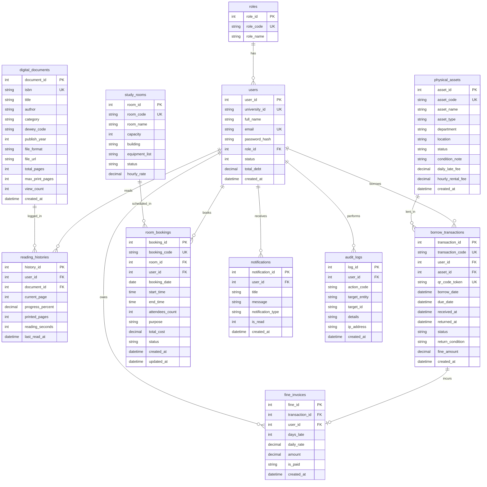

# Thiết kế Cơ sở Dữ liệu (Database Design)

## 1. Quy ước Đặt tên & Toàn vẹn Dữ liệu

Tuân thủ nghiêm ngặt tài liệu **Quy ước Viết mã (Coding Conventions)**:
- **Tên bảng (Tables)**: Sử dụng `snake_case` ở dạng **số nhiều** (`roles`, `users`, `digital_documents`, `reading_histories`, `physical_assets`, `borrow_transactions`, `fine_invoices`, `study_rooms`, `room_bookings`, `notifications`, `audit_logs`).
- **Tên cột (Columns)**: Sử dụng `snake_case` (`user_id`, `asset_id`, `room_id`, `created_at`, `due_date`, `returned_at`).
- **Ràng buộc Toàn vẹn (Data Integrity - NFR #3)**: Tất cả các khóa ngoại liên kết đến tài sản (`physical_assets`), tài liệu (`digital_documents`), phòng học (`study_rooms`) và người dùng (`users`) đều sử dụng `ON DELETE RESTRICT` để ngăn chặn việc xóa hồ sơ tài sản khi đang còn phiếu mượn hoạt động hoặc công nợ chưa thanh toán.

---

## 2. Sơ đồ Thực thể Kết hợp (ERD)

---

## 3. Mô tả Chi tiết Các Bảng Dữ liệu Chính

### 3.1. Bảng `users` & `roles`
- Lưu trữ thông tin định danh sinh viên, giảng viên, cán bộ thư viện và quản trị viên.
- Cột `status`: `1` (`STATUS_ACTIVE`), `2` (`STATUS_LOCKED` - tự động khóa khi `total_debt >= 100000`).
- Cột `password_hash`: Lưu trữ chuỗi băm chuẩn `bcrypt`.

### 3.2. Bảng `digital_documents` & `reading_histories` (Phân hệ 1)
- `isbn`: Có ràng buộc `UNIQUE` để chống trùng lặp khi nhập kho (F-01).
- `dewey_code`: Mã phân loại thập phân Dewey (ví dụ: `005.1` cho Lập trình máy tính, `621.3` cho Kỹ thuật điện tử).
- `reading_histories`: Lưu vết trang đang đọc (`current_page`), tiến độ (`progress_percent`), tổng thời gian đọc (`reading_seconds`) và số trang đã in (`printed_pages` <= `max_print_pages`).

### 3.3. Bảng `physical_assets`, `borrow_transactions` & `fine_invoices` (Phân hệ 2 & 3)
- `physical_assets.status`: Chỉ nhận một trong 3 giá trị chuẩn hóa: `AVAILABLE` (Còn trống - Màu xanh), `BORROWED` (Đang mượn - Màu đỏ), `MAINTENANCE` (Bảo trì - Màu xám).
- `borrow_transactions.qr_code_token`: Chuỗi định danh duy nhất sinh ra khi đặt mượn trực tuyến để Cán bộ Thư viện quét xác nhận bàn giao hoặc nhận trả tại quầy (F-03, F-04).

### 3.4. Bảng `study_rooms` & `room_bookings` (Phân hệ 4)
- Kiểm soát lịch đặt phòng theo ngày (`booking_date`) và khung giờ (`start_time`, `end_time`).
- Hỗ trợ kiểm tra xung đột thời gian thực và lưu trữ lịch sử hủy/dời lịch (`status`: `CONFIRMED`, `CANCELLED`, `COMPLETED`).

### 3.5. Bảng `audit_logs` (Phân hệ 6)
- Ghi nhận đầy đủ: Người thực hiện (`user_id`), Hành động (`action_code`), Đối tượng tác động (`target_entity`, `target_id`), Chi tiết JSON (`details`), Địa chỉ IP (`ip_address`) và Thời gian thực hiện (`created_at`).
