# Tài liệu Thiết kế Cơ sở Dữ liệu

## Chương 3. Thiết kế cơ sở dữ liệu (PostgreSQL 16)

### 3.1. Xác định các thực thể

Cơ sở dữ liệu được thiết kế trên hệ quản trị **PostgreSQL 16**, chuẩn hóa ở dạng chuẩn 3 (3NF) gồm **11 bảng** phục vụ trọn vẹn 6 phân hệ chức năng (`F-01` → `F-12`) và cổng thanh toán (`F-06b`):

| STT | Tên bảng | Vai trò lưu trữ | Phân hệ phục vụ |
| --- | --- | --- | --- |
| 1 | `roles` | Danh mục 4 vai trò: Sinh viên, Giảng viên, Cán bộ Thư viện, Quản trị viên | `F-11` |
| 2 | `users` | Hồ sơ người dùng và trạng thái tài khoản trường | `F-11` |
| 3 | `login_otps` | Mã xác thực OTP một lần (đã băm), thời hạn và số lần thử sai | `F-11` |
| 4 | `categories` | Danh mục phân loại học liệu, thiết bị và không gian phòng (đa cấp) | `F-01` |
| 5 | `resources` | Kho hợp nhất 3 nhóm tài nguyên: Tài liệu số, Tài sản vật lý và Phòng học | `F-01`, `F-02`, `F-03`, `F-07` |
| 6 | `loans` | Phiếu đặt mượn tài sản & lịch đặt phòng học kèm mã QR giao/nhận | `F-03`, `F-04`, `F-07`, `F-08` |
| 7 | `penalties` | Phiếu phạt vi phạm (trả trễ hạn, làm hư hỏng hoặc làm mất tài sản) | `F-06`, `F-09`, `F-10` |
| 8 | `payments` | Lịch sử giao dịch thanh toán phí phạt qua VNPay và MoMo | `F-06b` |
| 9 | `notifications` | Lịch sử thông báo đẩy trên web và email nhắc hạn trả tự động | `F-05` |
| 10 | `system_settings` | Bảng tham số cấu hình động của hệ thống (hạn mức, đơn giá phạt, thời gian giữ chỗ) | `F-06`, `F-08`, `F-11` |
| 11 | `audit_logs` | Nhật ký kiểm toán lưu vết mọi thao tác quan trọng trên hệ thống | `F-12` |

---

### 3.2. Sơ đồ Quan hệ Thực thể (ERD)

```mermaid
erDiagram
  ROLES ||--o{ USERS : "phân quyền"
  USERS ||--o{ LOGIN_OTPS : "yêu cầu mã"
  CATEGORIES ||--o{ CATEGORIES : "danh mục con"
  CATEGORIES ||--o{ RESOURCES : "phân loại"
  USERS ||--o{ LOANS : "đặt mượn"
  USERS ||--o{ LOANS : "duyệt / nhận trả"
  RESOURCES ||--o{ LOANS : "được đặt"
  LOANS ||--o{ PENALTIES : "phát sinh phạt"
  USERS ||--o{ PENALTIES : "chịu phạt"
  PENALTIES ||--o{ PAYMENTS : "thanh toán qua"
  USERS ||--o{ NOTIFICATIONS : "nhận thông báo"
  LOANS ||--o{ NOTIFICATIONS : "nhắc hạn cho"
  USERS ||--o{ SYSTEM_SETTINGS : "cấu hình"
  USERS ||--o{ AUDIT_LOGS : "thực hiện"

  ROLES {
    bigserial role_id PK
    varchar role_name UK
    varchar description
  }
  USERS {
    bigserial user_id PK
    varchar email UK
    varchar full_name
    varchar user_code UK
    varchar phone
    bigint role_id FK
    varchar status
    timestamp created_at
    timestamp last_login_at
  }
  LOGIN_OTPS {
    bigserial otp_id PK
    varchar email
    varchar otp_hash
    int attempts
    timestamp expires_at
    timestamp created_at
  }
  CATEGORIES {
    bigserial category_id PK
    varchar category_name
    bigint parent_id FK
  }
  RESOURCES {
    bigserial resource_id PK
    bigint category_id FK
    varchar resource_type
    varchar title
    varchar author_or_brand
    varchar code UK
    varchar file_url
    text description
    varchar location
    int total_quantity
    int available_quantity
    varchar status
    timestamp created_at
    timestamp updated_at
  }
  LOANS {
    bigserial loan_id PK
    varchar qr_token UK
    bigint user_id FK
    bigint resource_id FK
    varchar status
    timestamp borrow_from
    timestamp due_date
    timestamp requested_at
    timestamp hold_expires_at
    bigint approved_by FK
    timestamp approved_at
    bigint received_by FK
    timestamp returned_at
    varchar return_condition
    varchar reject_reason
  }
  PENALTIES {
    bigserial penalty_id PK
    bigint loan_id FK
    bigint user_id FK
    varchar penalty_type
    int overdue_days
    numeric amount
    varchar status
    varchar note
    bigint created_by FK
    timestamp created_at
    timestamp paid_at
  }
  PAYMENTS {
    bigserial payment_id PK
    bigint penalty_id FK
    varchar gateway
    varchar txn_ref UK
    varchar gateway_txn_no
    numeric amount
    varchar status
    varchar response_code
    timestamp created_at
    timestamp paid_at
  }
  NOTIFICATIONS {
    bigserial notification_id PK
    bigint user_id FK
    bigint loan_id FK
    varchar type
    varchar message
    boolean is_read
    timestamp created_at
    timestamp sent_at
  }
  SYSTEM_SETTINGS {
    varchar setting_key PK
    varchar setting_value
    varchar description
    bigint updated_by FK
    timestamp updated_at
  }
  AUDIT_LOGS {
    bigserial log_id PK
    bigint user_id FK
    varchar action
    varchar entity_type
    bigint entity_id
    jsonb details
    varchar ip_address
    timestamp created_at
  }
```



*Hình 3.1. Sơ đồ ERD tổng thể của hệ thống trên PostgreSQL 16.*

---

### 3.3. Giải thích mô hình lưu trữ cốt lõi

- **Hợp nhất 3 nhóm tài nguyên trong bảng `resources`:** Phân biệt qua trường `resource_type` gồm `DIGITAL` (Tài liệu số có `file_url` để mở Online Reader `F-02`, không giới hạn tồn kho vật lý), `BOOK` (Sách in), `EQUIPMENT` (Thiết bị học tập) và `ROOM` (Phòng học có `total_quantity = 1`). Trạng thái hiển thị màu sắc trên UI dựa vào `status` và `available_quantity` (Xanh: `ACTIVE` & còn trống; Đỏ: `available_quantity = 0`; Xám: `MAINTENANCE`).
- **Quản lý mượn tài sản & đặt phòng trên bảng `loans`:** Cả mượn sách theo ngày (`F-03`) và đặt phòng theo khung giờ (`F-07`) đều dùng cặp mốc thời gian `borrow_from` → `due_date`. Cột `qr_token` sinh chuỗi định danh duy nhất phục vụ quét mã QR nhận/trả nhanh tại quầy (`F-04`).
- **Xác thực không mật khẩu (`login_otps`):** Hệ thống không lưu mật khẩu cố định mà tạo mã OTP 6 số gửi qua email trường, chỉ lưu chuỗi băm `otp_hash` kèm bộ đếm `attempts` để chống dò mã tự động (`F-11`).
- **Nhật ký kiểm toán (`audit_logs`):** Sử dụng kiểu dữ liệu `JSONB` đặc trưng của PostgreSQL ở cột `details` để lưu linh hoạt dữ liệu trước/sau khi thay đổi của mọi hành động mượn, trả, hủy, phạt và cấu hình (`F-12`).

---

### 3.4. Từ điển Dữ liệu (Data Dictionary)

**1. Bảng `roles`**

| Thuộc tính | Kiểu dữ liệu | PK/FK | Ràng buộc | Ý nghĩa |
| --- | --- | --- | --- | --- |
| `role_id` | `BIGSERIAL` | PK | `NOT NULL` | Mã định danh vai trò tự tăng |
| `role_name` | `VARCHAR(30)` | | `UNIQUE, NOT NULL` | `STUDENT`, `LECTURER`, `LIBRARIAN`, `ADMIN` |
| `description` | `VARCHAR(255)` | | `NULL` | Mô tả phạm vi quyền hạn |

**2. Bảng `users`**

| Thuộc tính | Kiểu dữ liệu | PK/FK | Ràng buộc | Ý nghĩa |
| --- | --- | --- | --- | --- |
| `user_id` | `BIGSERIAL` | PK | `NOT NULL` | Mã định danh người dùng |
| `email` | `VARCHAR(100)` | | `UNIQUE, NOT NULL` | Email nhà trường dùng nhận OTP (`BR08`) |
| `full_name` | `VARCHAR(100)` | | `NOT NULL` | Họ và tên đầy đủ |
| `user_code` | `VARCHAR(20)` | | `UNIQUE, NOT NULL` | MSSV, Mã giảng viên hoặc Mã cán bộ |
| `phone` | `VARCHAR(20)` | | `NULL` | Số điện thoại liên hệ |
| `role_id` | `BIGINT` | FK → `roles` | `NOT NULL` | Vai trò phân quyền RBAC (`BR07`) |
| `status` | `VARCHAR(20)` | | `DEFAULT 'ACTIVE'` | `ACTIVE` hoặc `LOCKED` |
| `created_at` | `TIMESTAMP` | | `NOT NULL` | Thời điểm tạo tài khoản |
| `last_login_at` | `TIMESTAMP` | | `NULL` | Thời điểm đăng nhập OTP gần nhất |

**3. Bảng `login_otps`**

| Thuộc tính | Kiểu dữ liệu | PK/FK | Ràng buộc | Ý nghĩa |
| --- | --- | --- | --- | --- |
| `otp_id` | `BIGSERIAL` | PK | `NOT NULL` | Mã bản ghi OTP |
| `email` | `VARCHAR(100)` | | `NOT NULL` | Email người dùng yêu cầu mã |
| `otp_hash` | `VARCHAR(255)` | | `NOT NULL` | Bản băm một chiều (Bcrypt) của mã 6 chữ số |
| `attempts` | `INT` | | `DEFAULT 0` | Số lần nhập sai (tối đa 5 lần) |
| `expires_at` | `TIMESTAMP` | | `NOT NULL` | Thời điểm hết hạn (mặc định sau 5 phút) |
| `created_at` | `TIMESTAMP` | | `NOT NULL` | Thời điểm phát hành mã (kiểm tra chờ 60s gửi lại) |

**4. Bảng `categories`**

| Thuộc tính | Kiểu dữ liệu | PK/FK | Ràng buộc | Ý nghĩa |
| --- | --- | --- | --- | --- |
| `category_id` | `BIGSERIAL` | PK | `NOT NULL` | Mã danh mục |
| `category_name` | `VARCHAR(100)` | | `NOT NULL` | Tên danh mục / Phân loại Dewey |
| `parent_id` | `BIGINT` | FK → `categories` | `NULL` | Danh mục cha (`NULL` nếu là danh mục gốc) |

**5. Bảng `resources`**

| Thuộc tính | Kiểu dữ liệu | PK/FK | Ràng buộc | Ý nghĩa |
| --- | --- | --- | --- | --- |
| `resource_id` | `BIGSERIAL` | PK | `NOT NULL` | Mã tài nguyên |
| `category_id` | `BIGINT` | FK → `categories` | `NOT NULL` | Danh mục phân loại |
| `resource_type` | `VARCHAR(20)` | | `NOT NULL` | `DIGITAL`, `BOOK`, `EQUIPMENT`, `ROOM` |
| `title` | `VARCHAR(255)` | | `NOT NULL` | Tên tài liệu, thiết bị hoặc tên phòng học |
| `author_or_brand` | `VARCHAR(150)` | | `NULL` | Tác giả (sách/tài liệu số) hoặc Hãng sản xuất |
| `code` | `VARCHAR(50)` | | `UNIQUE, NOT NULL` | Mã ISBN, Serial thiết bị hoặc Mã phòng |
| `file_url` | `VARCHAR(500)` | | `NULL` | Đường dẫn tệp PDF/EPUB cho `DIGITAL` (`F-02`) |
| `description` | `TEXT` | | `NULL` | Mô tả chi tiết / sức chứa phòng |
| `location` | `VARCHAR(100)` | | `NULL` | Vị trí kệ sách, kho thiết bị hoặc tòa nhà |
| `total_quantity` | `INT` | | `CHECK (total_quantity >= 0)` | Tổng số lượng sở hữu |
| `available_quantity` | `INT` | | `CHECK (0 <= available_quantity AND available_quantity <= total_quantity)` | Số lượng khả dụng hiện tại (đã trừ giữ chỗ) |
| `status` | `VARCHAR(20)` | | `DEFAULT 'ACTIVE'` | `ACTIVE` (Hoạt động), `MAINTENANCE` (Bảo trì), `INACTIVE` (Ẩn/Xóa mềm) |
| `created_at` | `TIMESTAMP` | | `NOT NULL` | Thời điểm tạo |
| `updated_at` | `TIMESTAMP` | | `NOT NULL` | Thời điểm cập nhật gần nhất |

**6. Bảng `loans`**

| Thuộc tính | Kiểu dữ liệu | PK/FK | Ràng buộc | Ý nghĩa |
| --- | --- | --- | --- | --- |
| `loan_id` | `BIGSERIAL` | PK | `NOT NULL` | Mã phiếu mượn / phiếu đặt phòng |
| `qr_token` | `VARCHAR(64)` | | `UNIQUE, NOT NULL` | Chuỗi mã hóa dùng tạo mã QR quét tại quầy (`F-04`) |
| `user_id` | `BIGINT` | FK → `users` | `NOT NULL` | Sinh viên / Giảng viên đặt mượn |
| `resource_id` | `BIGINT` | FK → `resources` | `NOT NULL` | Tài sản hoặc phòng học được đặt |
| `status` | `VARCHAR(20)` | | `NOT NULL` | `HOLDING`, `PENDING`, `BORROWING`, `RETURNED`, `REJECTED`, `CANCELLED`, `EXPIRED` |
| `borrow_from` | `TIMESTAMP` | | `NOT NULL` | Thời điểm bắt đầu mượn / bắt đầu dùng phòng |
| `due_date` | `TIMESTAMP` | | `CHECK (due_date > borrow_from)` | Thời hạn phải trả / kết thúc khung giờ phòng |
| `requested_at` | `TIMESTAMP` | | `NOT NULL` | Thời điểm khởi tạo yêu cầu |
| `hold_expires_at` | `TIMESTAMP` | | `NULL` | Thời điểm hết hạn giữ chỗ 10 phút (`HOLDING`) |
| `approved_by` | `BIGINT` | FK → `users` | `NULL` | Thủ thư xác nhận giao tài sản / duyệt phiếu |
| `approved_at` | `TIMESTAMP` | | `NULL` | Thời điểm bàn giao tài sản |
| `received_by` | `BIGINT` | FK → `users` | `NULL` | Thủ thư quét QR nhận trả tài sản |
| `returned_at` | `TIMESTAMP` | | `NULL` | Thời điểm trả thực tế |
| `return_condition` | `VARCHAR(20)` | | `NULL` | `GOOD`, `DAMAGED` hoặc `LOST` |
| `reject_reason` | `VARCHAR(255)` | | `NULL` | Lý do từ chối hoặc ghi chú hủy lịch |

**7. Bảng `penalties`**

| Thuộc tính | Kiểu dữ liệu | PK/FK | Ràng buộc | Ý nghĩa |
| --- | --- | --- | --- | --- |
| `penalty_id` | `BIGSERIAL` | PK | `NOT NULL` | Mã phiếu phạt |
| `loan_id` | `BIGINT` | FK → `loans` | `NOT NULL` | Phiếu mượn phát sinh vi phạm |
| `user_id` | `BIGINT` | FK → `users` | `NOT NULL` | Người dùng chịu phí phạt |
| `penalty_type` | `VARCHAR(20)` | | `NOT NULL` | `OVERDUE` (Trễ hạn), `DAMAGED` (Hư hỏng), `LOST` (Làm mất) |
| `overdue_days` | `INT` | | `CHECK (overdue_days >= 0)` | Số ngày trễ hạn |
| `amount` | `NUMERIC(12,0)` | | `CHECK (amount > 0)` | Số tiền phạt tính bằng VNĐ |
| `status` | `VARCHAR(20)` | | `DEFAULT 'UNPAID'` | `UNPAID` (Chưa đóng) hoặc `PAID` (Đã tất toán) |
| `note` | `VARCHAR(255)` | | `NULL` | Mô tả chi tiết tình trạng hư hỏng |
| `created_by` | `BIGINT` | FK → `users` | `NULL` | Thủ thư lập phiếu (`NULL` nếu tự động tính) |
| `created_at` | `TIMESTAMP` | | `NOT NULL` | Thời điểm ghi nhận công nợ |
| `paid_at` | `TIMESTAMP` | | `NULL` | Thời điểm thanh toán hoàn tất |

**8. Bảng `payments`**

| Thuộc tính | Kiểu dữ liệu | PK/FK | Ràng buộc | Ý nghĩa |
| --- | --- | --- | --- | --- |
| `payment_id` | `BIGSERIAL` | PK | `NOT NULL` | Mã giao dịch thanh toán |
| `penalty_id` | `BIGINT` | FK → `penalties` | `NOT NULL` | Phiếu phạt được thanh toán |
| `gateway` | `VARCHAR(20)` | | `NOT NULL` | `VNPAY` hoặc `MOMO` |
| `txn_ref` | `VARCHAR(64)` | | `UNIQUE, NOT NULL` | Mã tham chiếu duy nhất chống xử lý trùng IPN |
| `gateway_txn_no` | `VARCHAR(64)` | | `NULL` | Mã giao dịch đối soát phía cổng thanh toán |
| `amount` | `NUMERIC(12,0)` | | `CHECK (amount > 0)` | Số tiền giao dịch (VNĐ) |
| `status` | `VARCHAR(20)` | | `DEFAULT 'PENDING'` | `PENDING`, `SUCCESS`, `FAILED` |
| `response_code` | `VARCHAR(20)` | | `NULL` | Mã phản hồi từ VNPay / MoMo |
| `created_at` | `TIMESTAMP` | | `NOT NULL` | Thời điểm khởi tạo lệnh thanh toán |
| `paid_at` | `TIMESTAMP` | | `NULL` | Thời điểm nhận IPN thành công |

**9. Bảng `notifications`**

| Thuộc tính | Kiểu dữ liệu | PK/FK | Ràng buộc | Ý nghĩa |
| --- | --- | --- | --- | --- |
| `notification_id` | `BIGSERIAL` | PK | `NOT NULL` | Mã thông báo |
| `user_id` | `BIGINT` | FK → `users` | `NOT NULL` | Người nhận thông báo |
| `loan_id` | `BIGINT` | FK → `loans` | `NULL` | Phiếu mượn liên quan |
| `type` | `VARCHAR(30)` | | `NOT NULL` | `DUE_REMINDER_3D`, `DUE_REMINDER_1D`, `LOAN_CONFIRMED` |
| `message` | `VARCHAR(500)` | | `NOT NULL` | Nội dung thông báo hiển thị |
| `is_read` | `BOOLEAN` | | `DEFAULT FALSE` | Trạng thái đã xem trên web |
| `created_at` | `TIMESTAMP` | | `NOT NULL` | Thời điểm sinh thông báo |
| `sent_at` | `TIMESTAMP` | | `NULL` | Thời điểm gửi email thành công |

**10. Bảng `system_settings`**

| Thuộc tính | Kiểu dữ liệu | PK/FK | Ràng buộc | Ý nghĩa |
| --- | --- | --- | --- | --- |
| `setting_key` | `VARCHAR(50)` | PK | `NOT NULL` | Khóa cấu hình (`MAX_ACTIVE_LOANS`, `FINE_PER_DAY`, `HOLD_MINUTES`, `ROOM_CANCEL_HOURS`...) |
| `setting_value` | `VARCHAR(100)` | | `NOT NULL` | Giá trị cấu hình hiện hành |
| `description` | `VARCHAR(255)` | | `NULL` | Giải thích ý nghĩa tham số |
| `updated_by` | `BIGINT` | FK → `users` | `NULL` | Quản trị viên chỉnh sửa lần cuối |
| `updated_at` | `TIMESTAMP` | | `NOT NULL` | Thời điểm cập nhật |

**11. Bảng `audit_logs`**

| Thuộc tính | Kiểu dữ liệu | PK/FK | Ràng buộc | Ý nghĩa |
| --- | --- | --- | --- | --- |
| `log_id` | `BIGSERIAL` | PK | `NOT NULL` | Mã nhật ký kiểm toán |
| `user_id` | `BIGINT` | FK → `users` | `NULL` | Người thực hiện thao tác |
| `action` | `VARCHAR(50)` | | `NOT NULL` | Hành động (`LOGIN_OTP`, `HOLD_ASSET`, `RETURN_ASSET`, `CANCEL_ROOM`, `UPDATE_SETTING`...) |
| `entity_type` | `VARCHAR(50)` | | `NOT NULL` | Bảng bị tác động (`loans`, `resources`, `penalties`...) |
| `entity_id` | `BIGINT` | | `NULL` | Khóa chính của bản ghi bị tác động |
| `details` | `JSONB` | | `NULL` | Chi tiết thay đổi (giá trị cũ / mới) |
| `ip_address` | `VARCHAR(45)` | | `NULL` | Địa chỉ IP thực hiện |
| `created_at` | `TIMESTAMP` | | `NOT NULL` | Thời điểm ghi nhận nhật ký |

---

### 3.5. Ràng buộc Toàn vẹn và Chiến lược Đánh Chỉ mục (Indexing)

1. **Toàn vẹn tham chiếu (`ON DELETE RESTRICT`):** Toàn bộ khóa ngoại đều thiết lập `ON DELETE RESTRICT` nhằm cấm xóa vật lý tài sản hoặc người dùng khi đã phát sinh lịch sử mượn trả, công nợ hoặc nhật ký kiểm toán (đáp ứng tiêu chí Toàn vẹn dữ liệu của đề tài).
2. **Chống mượn trùng bằng Partial Unique Index (Đặc tả PostgreSQL 16):**
   ```sql
   CREATE UNIQUE INDEX uq_active_user_resource_loan
   ON loans (user_id, resource_id)
   WHERE status IN ('HOLDING', 'PENDING', 'BORROWING');
   ```
   Đảm bảo ngay từ tầng CSDL một người dùng không thể giữ hai phiếu đang hoạt động cho cùng một cuốn sách hoặc thiết bị.
3. **Chỉ mục tối ưu tốc độ tra cứu $< 2\text{ giây}$:**
   - **Full-Text Search Index (`GIN`):** Đánh chỉ mục `GIN (to_tsvector('simple', title || ' ' || coalesce(author_or_brand, '') || ' ' || code))` trên bảng `resources` giúp tìm kiếm từ khóa đa tiêu chí dưới 2 giây.
   - **Index quét giữ chỗ hết hạn:** `idx_loans_hold_expiry ON loans (status, hold_expires_at)` phục vụ Scheduler chạy mỗi phút.
   - **Index kiểm tra lịch trống phòng học & thiết bị:** `idx_loans_schedule ON loans (resource_id, borrow_from, due_date) WHERE status IN ('HOLDING', 'PENDING', 'BORROWING')`.
   - **Index kiểm tra nợ phạt tức thời:** `idx_penalties_unpaid ON penalties (user_id, status)` phục vụ kiểm tra `BR01`.
