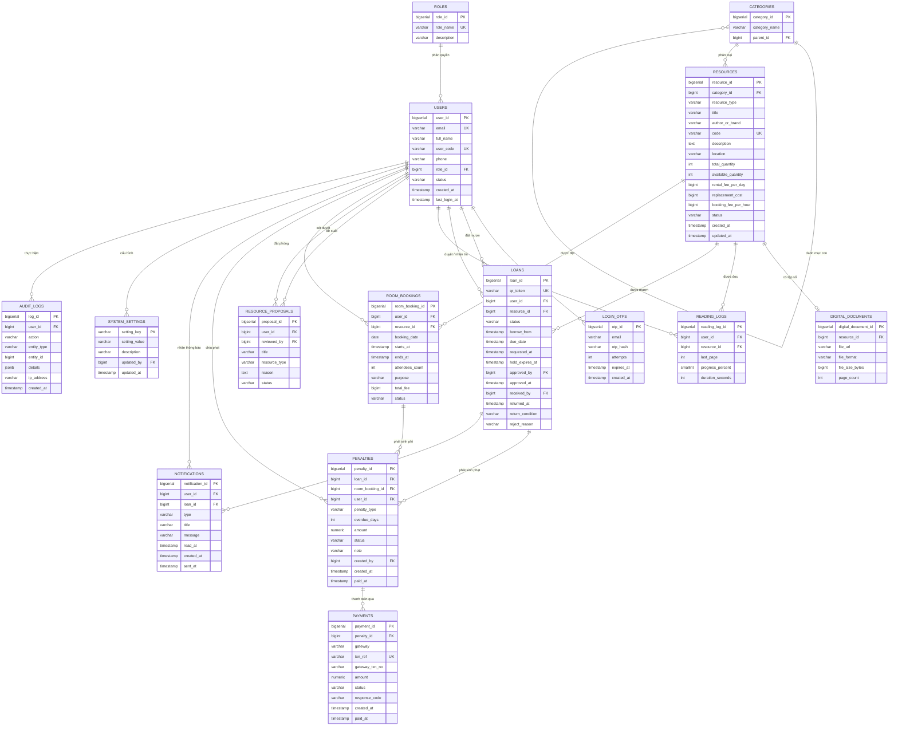

# Tài liệu Thiết kế Cơ sở Dữ liệu

## Chương 3. Thiết kế cơ sở dữ liệu (PostgreSQL 16)

### 3.1. Xác định các thực thể

Cơ sở dữ liệu được thiết kế trên hệ quản trị **PostgreSQL 16**, chuẩn hóa ở dạng chuẩn 3 (3NF) gồm **15 bảng** phục vụ trọn vẹn 6 phân hệ chức năng (`F-01` → `F-12`) và cổng thanh toán (`F-06b`):

| STT | Tên bảng | Vai trò lưu trữ | Phân hệ phục vụ |
| --- | --- | --- | --- |
| 1 | `roles` | Danh mục 4 vai trò: Sinh viên, Giảng viên, Cán bộ Thư viện, Quản trị viên | `F-11` |
| 2 | `users` | Hồ sơ người dùng và trạng thái tài khoản trường | `F-11` |
| 3 | `login_otps` | Mã xác thực OTP một lần (đã băm), thời hạn và số lần thử sai | `F-11` |
| 4 | `categories` | Danh mục phân loại học liệu, thiết bị và không gian phòng (đa cấp) | `F-01` |
| 5 | `resources` | Kho hợp nhất 4 loại tài nguyên: Tài liệu số, Sách in, Thiết bị và Phòng học, kèm đơn giá thuê, đền bù và đặt phòng | `F-01`, `F-02`, `F-03`, `F-07` |
| 6 | `digital_documents` | Metadata tệp PDF/EPUB của tài liệu số (liên kết 1–1 với `resources`) | `F-02` |
| 7 | `reading_logs` | Nhật ký đọc trực tuyến: trang đang đọc, % hoàn thành, thời gian đọc tích lũy | `F-02`, `F-09` |
| 8 | `resource_proposals` | Phiếu đề xuất học liệu mới của Giảng viên và kết quả xét duyệt | `F-01` |
| 9 | `loans` | Phiếu mượn sách in & thiết bị kèm mã QR giao/nhận | `F-03`, `F-04`, `F-08` |
| 10 | `room_bookings` | Lịch đặt phòng học theo khung giờ, phí đặt phòng và trạng thái | `F-07`, `F-08` |
| 11 | `penalties` | Phiếu phạt / khoản thu (trả trễ hạn, hư hỏng, mất, phí thuê thiết bị, phí đặt phòng) | `F-06`, `F-09`, `F-10` |
| 12 | `payments` | Lịch sử giao dịch thanh toán phí phạt qua VNPay và MoMo | `F-06b` |
| 13 | `notifications` | Lịch sử thông báo đẩy trên web và email nhắc hạn trả tự động | `F-05` |
| 14 | `system_settings` | Bảng tham số cấu hình động của hệ thống (hạn mức, đơn giá phạt, thời gian giữ chỗ) | `F-06`, `F-08`, `F-11` |
| 15 | `audit_logs` | Nhật ký kiểm toán lưu vết mọi thao tác quan trọng trên hệ thống | `F-12` |

---

### 3.2. Sơ đồ Quan hệ Thực thể (ERD)



*Hình 3.1. Sơ đồ ERD tổng thể của hệ thống trên PostgreSQL 16.*

---

### 3.3. Giải thích mô hình lưu trữ cốt lõi

- **Hợp nhất 4 loại tài nguyên trong bảng `resources`:** Phân biệt qua trường `resource_type` gồm `DIGITAL` (Tài liệu số, không giới hạn tồn kho vật lý; metadata tệp tách sang `digital_documents`), `BOOK` (Sách in), `EQUIPMENT` (Thiết bị học tập) và `ROOM` (Phòng học có `total_quantity = 1`). Các cột `rental_fee_per_day`, `replacement_cost`, `booking_fee_per_hour` lưu đơn giá thuê thiết bị, mức đền bù khi mất và đơn giá đặt phòng. Trạng thái hiển thị màu sắc trên UI dựa vào `status` và `available_quantity` (Xanh: `ACTIVE` & còn trống; Đỏ: `available_quantity = 0`; Xám: `MAINTENANCE`).
- **Tài liệu số và nhật ký đọc (`digital_documents`, `reading_logs`):** `digital_documents` lưu đường dẫn `file_url`, định dạng, dung lượng và số trang của tệp PDF/EPUB, liên kết 1–1 với tài nguyên `DIGITAL` để mở Online Reader (`F-02`) và là quan hệ Hợp thành (xóa tài liệu số thì xóa kèm thông tin tệp). `reading_logs` ghi lại trang đang đọc dở, % hoàn thành và thời gian đọc tích lũy, làm nguồn số liệu thống kê (`F-09`).
- **Đề xuất học liệu (`resource_proposals`):** Giảng viên gửi phiếu đề xuất tài liệu mới kèm lý do; Thủ thư/Admin xét duyệt qua trạng thái `PENDING`, `APPROVED`, `REJECTED` và ghi nhận người duyệt ở `reviewed_by`.
- **Quản lý mượn tài sản trên bảng `loans`:** Mượn sách in và thiết bị theo ngày (`F-03`) dùng cặp mốc thời gian `borrow_from` → `due_date`. Cột `qr_token` sinh chuỗi định danh duy nhất phục vụ quét mã QR nhận/trả nhanh tại quầy (`F-04`).
- **Đặt phòng học trên bảng `room_bookings`:** Mỗi lượt đặt phòng theo khung giờ (`F-07`) được lưu với `booking_date`, `starts_at` → `ends_at`, số người tham gia, mục đích và phí chốt `total_fee` (snapshot theo đơn giá `booking_fee_per_hour` tại thời điểm đặt). Hệ thống chỉ chấp nhận lượt đặt mới khi không tồn tại bản ghi `CONFIRMED` giao thoa thời gian trên cùng phòng.
- **Xác thực không mật khẩu (`login_otps`):** Hệ thống không lưu mật khẩu cố định mà tạo mã OTP 6 số gửi qua email trường, chỉ lưu chuỗi băm `otp_hash` kèm bộ đếm `attempts` để chống dò mã tự động (`F-11`).
- **Nhật ký kiểm toán (`audit_logs`):** Sử dụng kiểu dữ liệu `JSONB` đặc trưng của PostgreSQL ở cột `details` để lưu linh hoạt dữ liệu trước/sau khi thay đổi của mọi hành động mượn, trả, hủy, phạt và cấu hình (`F-12`).

---

### 3.4. Từ điển Dữ liệu (Data Dictionary)

**1. Bảng `roles`**

| Thuộc tính | Kiểu dữ liệu | PK/FK | Ràng buộc | Ý nghĩa |
| --- | --- | --- | --- | --- |
| `role_id` | `BIGSERIAL` | PK | `NOT NULL` | Mã định danh vai trò tự tăng |
| `role_name` | `VARCHAR(30)` | | `UNIQUE, NOT NULL` | `STUDENT`, `LECTURER`, `LIBRARIAN`, `ADMIN` |
| `description` | `VARCHAR(255)` | | `NULL` | Mô tả phạm vi quyền hạn |

**2. Bảng `users`**

| Thuộc tính | Kiểu dữ liệu | PK/FK | Ràng buộc | Ý nghĩa |
| --- | --- | --- | --- | --- |
| `user_id` | `BIGSERIAL` | PK | `NOT NULL` | Mã định danh người dùng |
| `email` | `VARCHAR(100)` | | `UNIQUE, NOT NULL` | Email nhà trường dùng nhận OTP (`BR08`) |
| `full_name` | `VARCHAR(100)` | | `NOT NULL` | Họ và tên đầy đủ |
| `user_code` | `VARCHAR(20)` | | `UNIQUE, NOT NULL` | MSSV, Mã giảng viên hoặc Mã cán bộ |
| `phone` | `VARCHAR(20)` | | `NULL` | Số điện thoại liên hệ |
| `role_id` | `BIGINT` | FK → `roles` | `NOT NULL` | Vai trò phân quyền RBAC (`BR07`) |
| `status` | `VARCHAR(20)` | | `DEFAULT 'ACTIVE'` | `ACTIVE` hoặc `LOCKED` |
| `created_at` | `TIMESTAMP` | | `NOT NULL` | Thời điểm tạo tài khoản |
| `last_login_at` | `TIMESTAMP` | | `NULL` | Thời điểm đăng nhập OTP gần nhất |

**3. Bảng `login_otps`**

| Thuộc tính | Kiểu dữ liệu | PK/FK | Ràng buộc | Ý nghĩa |
| --- | --- | --- | --- | --- |
| `otp_id` | `BIGSERIAL` | PK | `NOT NULL` | Mã bản ghi OTP |
| `email` | `VARCHAR(100)` | | `NOT NULL` | Email người dùng yêu cầu mã |
| `otp_hash` | `VARCHAR(255)` | | `NOT NULL` | Bản băm một chiều (Bcrypt) của mã 6 chữ số |
| `attempts` | `INT` | | `DEFAULT 0` | Số lần nhập sai (tối đa 5 lần) |
| `expires_at` | `TIMESTAMP` | | `NOT NULL` | Thời điểm hết hạn (mặc định sau 5 phút) |
| `created_at` | `TIMESTAMP` | | `NOT NULL` | Thời điểm phát hành mã (kiểm tra chờ 60s gửi lại) |

**4. Bảng `categories`**

| Thuộc tính | Kiểu dữ liệu | PK/FK | Ràng buộc | Ý nghĩa |
| --- | --- | --- | --- | --- |
| `category_id` | `BIGSERIAL` | PK | `NOT NULL` | Mã danh mục |
| `category_name` | `VARCHAR(100)` | | `NOT NULL` | Tên danh mục / Phân loại Dewey |
| `parent_id` | `BIGINT` | FK → `categories` | `NULL` | Danh mục cha (`NULL` nếu là danh mục gốc) |

**5. Bảng `resources`**

| Thuộc tính | Kiểu dữ liệu | PK/FK | Ràng buộc | Ý nghĩa |
| --- | --- | --- | --- | --- |
| `resource_id` | `BIGSERIAL` | PK | `NOT NULL` | Mã tài nguyên |
| `category_id` | `BIGINT` | FK → `categories` | `NOT NULL` | Danh mục phân loại |
| `resource_type` | `VARCHAR(20)` | | `NOT NULL` | `DIGITAL`, `BOOK`, `EQUIPMENT`, `ROOM` |
| `title` | `VARCHAR(255)` | | `NOT NULL` | Tên tài liệu, thiết bị hoặc tên phòng học |
| `author_or_brand` | `VARCHAR(150)` | | `NULL` | Tác giả (sách/tài liệu số) hoặc Hãng sản xuất |
| `code` | `VARCHAR(50)` | | `UNIQUE, NOT NULL` | Mã ISBN, Serial thiết bị hoặc Mã phòng |
| `description` | `TEXT` | | `NULL` | Mô tả chi tiết / sức chứa phòng |
| `location` | `VARCHAR(100)` | | `NULL` | Vị trí kệ sách, kho thiết bị hoặc tòa nhà |
| `total_quantity` | `INT` | | `CHECK (total_quantity >= 0)` | Tổng số lượng sở hữu |
| `available_quantity` | `INT` | | `CHECK (0 <= available_quantity AND available_quantity <= total_quantity)` | Số lượng khả dụng hiện tại (đã trừ giữ chỗ) |
| `rental_fee_per_day` | `BIGINT` | | `CHECK (rental_fee_per_day >= 0), DEFAULT 0` | Phí thuê thiết bị theo ngày (VNĐ) |
| `replacement_cost` | `BIGINT` | | `CHECK (replacement_cost >= 0), DEFAULT 0` | Mức đền bù khi làm mất tài sản (VNĐ) |
| `booking_fee_per_hour` | `BIGINT` | | `CHECK (booking_fee_per_hour >= 0), DEFAULT 0` | Đơn giá đặt phòng theo giờ (VNĐ) |
| `status` | `VARCHAR(20)` | | `DEFAULT 'ACTIVE'` | `ACTIVE` (Hoạt động), `MAINTENANCE` (Bảo trì), `INACTIVE` (Ẩn/Xóa mềm) |
| `created_at` | `TIMESTAMP` | | `NOT NULL` | Thời điểm tạo |
| `updated_at` | `TIMESTAMP` | | `NOT NULL` | Thời điểm cập nhật gần nhất |

**6. Bảng `digital_documents`**

| Thuộc tính | Kiểu dữ liệu | PK/FK | Ràng buộc | Ý nghĩa |
| --- | --- | --- | --- | --- |
| `digital_document_id` | `BIGSERIAL` | PK | `NOT NULL` | Mã metadata tệp số |
| `resource_id` | `BIGINT` | FK → `resources` | `UNIQUE, NOT NULL` | Tài nguyên `DIGITAL` sở hữu tệp (liên kết 1–1, `ON DELETE CASCADE`) |
| `file_url` | `VARCHAR(500)` | | `NOT NULL` | Đường dẫn tệp PDF/EPUB cho Online Reader (`F-02`) |
| `file_format` | `VARCHAR(10)` | | `NOT NULL` | Định dạng tệp: `PDF` hoặc `EPUB` |
| `file_size_bytes` | `BIGINT` | | `NULL` | Dung lượng tệp (byte) |
| `page_count` | `INT` | | `NULL` | Tổng số trang |

**7. Bảng `reading_logs`**

| Thuộc tính | Kiểu dữ liệu | PK/FK | Ràng buộc | Ý nghĩa |
| --- | --- | --- | --- | --- |
| `reading_log_id` | `BIGSERIAL` | PK | `NOT NULL` | Mã nhật ký đọc |
| `user_id` | `BIGINT` | FK → `users` | `NOT NULL` | Người đọc |
| `resource_id` | `BIGINT` | FK → `resources` | `NOT NULL` | Tài liệu số được đọc (`ON DELETE CASCADE`) |
| `last_page` | `INT` | | `NULL` | Trang đang đọc dở |
| `progress_percent` | `SMALLINT` | | `CHECK (progress_percent BETWEEN 0 AND 100)` | Phần trăm hoàn thành |
| `duration_seconds` | `INT` | | `DEFAULT 0` | Thời gian đọc tích lũy (giây), phục vụ thống kê `F-09` |

**8. Bảng `resource_proposals`**

| Thuộc tính | Kiểu dữ liệu | PK/FK | Ràng buộc | Ý nghĩa |
| --- | --- | --- | --- | --- |
| `proposal_id` | `BIGSERIAL` | PK | `NOT NULL` | Mã phiếu đề xuất |
| `user_id` | `BIGINT` | FK → `users` | `NOT NULL` | Giảng viên đề xuất |
| `reviewed_by` | `BIGINT` | FK → `users` | `NULL` | Thủ thư / Admin xét duyệt |
| `title` | `VARCHAR(255)` | | `NOT NULL` | Tên tài liệu đề xuất |
| `resource_type` | `VARCHAR(20)` | | `NOT NULL` | Loại tài liệu đề xuất (`DIGITAL`, `BOOK`, `EQUIPMENT`) |
| `reason` | `TEXT` | | `NULL` | Lý do đề xuất |
| `status` | `VARCHAR(20)` | | `DEFAULT 'PENDING'` | `PENDING`, `APPROVED`, `REJECTED` |

**9. Bảng `loans`**

| Thuộc tính | Kiểu dữ liệu | PK/FK | Ràng buộc | Ý nghĩa |
| --- | --- | --- | --- | --- |
| `loan_id` | `BIGSERIAL` | PK | `NOT NULL` | Mã phiếu mượn sách in / thiết bị |
| `qr_token` | `VARCHAR(64)` | | `UNIQUE, NOT NULL` | Chuỗi mã hóa dùng tạo mã QR quét tại quầy (`F-04`) |
| `user_id` | `BIGINT` | FK → `users` | `NOT NULL` | Sinh viên / Giảng viên đặt mượn |
| `resource_id` | `BIGINT` | FK → `resources` | `NOT NULL` | Sách in hoặc thiết bị được mượn |
| `status` | `VARCHAR(20)` | | `NOT NULL` | `HOLDING`, `PENDING`, `BORROWING`, `RETURNED`, `REJECTED`, `CANCELLED`, `EXPIRED` |
| `borrow_from` | `TIMESTAMP` | | `NOT NULL` | Thời điểm bắt đầu mượn |
| `due_date` | `TIMESTAMP` | | `CHECK (due_date > borrow_from)` | Thời hạn phải trả |
| `requested_at` | `TIMESTAMP` | | `NOT NULL` | Thời điểm khởi tạo yêu cầu |
| `hold_expires_at` | `TIMESTAMP` | | `NULL` | Thời điểm hết hạn giữ chỗ 10 phút (`HOLDING`) |
| `approved_by` | `BIGINT` | FK → `users` | `NULL` | Thủ thư xác nhận giao tài sản / duyệt phiếu |
| `approved_at` | `TIMESTAMP` | | `NULL` | Thời điểm bàn giao tài sản |
| `received_by` | `BIGINT` | FK → `users` | `NULL` | Thủ thư quét QR nhận trả tài sản |
| `returned_at` | `TIMESTAMP` | | `NULL` | Thời điểm trả thực tế |
| `return_condition` | `VARCHAR(20)` | | `NULL` | `GOOD`, `DAMAGED` hoặc `LOST` |
| `reject_reason` | `VARCHAR(255)` | | `NULL` | Lý do từ chối phiếu |

**10. Bảng `room_bookings`**

| Thuộc tính | Kiểu dữ liệu | PK/FK | Ràng buộc | Ý nghĩa |
| --- | --- | --- | --- | --- |
| `room_booking_id` | `BIGSERIAL` | PK | `NOT NULL` | Mã lượt đặt phòng học |
| `user_id` | `BIGINT` | FK → `users` | `NOT NULL` | Người đặt phòng |
| `resource_id` | `BIGINT` | FK → `resources` | `NOT NULL` | Phòng học được đặt (`resource_type = 'ROOM'`) |
| `booking_date` | `DATE` | | `NOT NULL` | Ngày sử dụng phòng |
| `starts_at` | `TIMESTAMP` | | `NOT NULL` | Thời điểm bắt đầu khung giờ |
| `ends_at` | `TIMESTAMP` | | `CHECK (ends_at > starts_at)` | Thời điểm kết thúc khung giờ |
| `attendees_count` | `INT` | | `NULL` | Số người tham gia |
| `purpose` | `VARCHAR(255)` | | `NULL` | Mục đích sử dụng phòng |
| `total_fee` | `BIGINT` | | `DEFAULT 0` | Phí đặt phòng chốt tại thời điểm đặt (VNĐ) |
| `status` | `VARCHAR(20)` | | `DEFAULT 'CONFIRMED'` | `CONFIRMED` hoặc `CANCELLED` |

**11. Bảng `penalties`**

| Thuộc tính | Kiểu dữ liệu | PK/FK | Ràng buộc | Ý nghĩa |
| --- | --- | --- | --- | --- |
| `penalty_id` | `BIGSERIAL` | PK | `NOT NULL` | Mã phiếu phạt |
| `loan_id` | `BIGINT` | FK → `loans` | `NULL` | Phiếu mượn phát sinh vi phạm (`NULL` nếu phát sinh từ lượt đặt phòng) |
| `room_booking_id` | `BIGINT` | FK → `room_bookings` | `NULL` | Lượt đặt phòng phát sinh phí (`NULL` nếu phát sinh từ phiếu mượn) |
| `user_id` | `BIGINT` | FK → `users` | `NOT NULL` | Người dùng chịu phí phạt |
| `penalty_type` | `VARCHAR(20)` | | `NOT NULL` | `OVERDUE` (Trễ hạn), `DAMAGED` (Hư hỏng), `LOST` (Làm mất), `RENTAL` (Phí thuê thiết bị), `ROOM_BOOKING` (Phí đặt phòng) |
| `overdue_days` | `INT` | | `CHECK (overdue_days >= 0)` | Số ngày trễ hạn |
| `amount` | `NUMERIC(12,0)` | | `CHECK (amount > 0)` | Số tiền phạt tính bằng VNĐ |
| `status` | `VARCHAR(20)` | | `DEFAULT 'UNPAID'` | `UNPAID` (Chưa đóng), `PAID` (Đã tất toán) hoặc `WAIVED` (Miễn) |
| `note` | `VARCHAR(255)` | | `NULL` | Mô tả chi tiết tình trạng hư hỏng |
| `created_by` | `BIGINT` | FK → `users` | `NULL` | Thủ thư lập phiếu (`NULL` nếu tự động tính) |
| `created_at` | `TIMESTAMP` | | `NOT NULL` | Thời điểm ghi nhận công nợ |
| `paid_at` | `TIMESTAMP` | | `NULL` | Thời điểm thanh toán hoàn tất |

**12. Bảng `payments`**

| Thuộc tính | Kiểu dữ liệu | PK/FK | Ràng buộc | Ý nghĩa |
| --- | --- | --- | --- | --- |
| `payment_id` | `BIGSERIAL` | PK | `NOT NULL` | Mã giao dịch thanh toán |
| `penalty_id` | `BIGINT` | FK → `penalties` | `NOT NULL` | Phiếu phạt được thanh toán |
| `gateway` | `VARCHAR(20)` | | `NOT NULL` | `VNPAY` hoặc `MOMO` |
| `txn_ref` | `VARCHAR(64)` | | `UNIQUE, NOT NULL` | Mã tham chiếu duy nhất chống xử lý trùng IPN |
| `gateway_txn_no` | `VARCHAR(64)` | | `NULL` | Mã giao dịch đối soát phía cổng thanh toán |
| `amount` | `NUMERIC(12,0)` | | `CHECK (amount > 0)` | Số tiền giao dịch (VNĐ) |
| `status` | `VARCHAR(20)` | | `DEFAULT 'PENDING'` | `PENDING`, `SUCCESS`, `FAILED` |
| `response_code` | `VARCHAR(20)` | | `NULL` | Mã phản hồi từ VNPay / MoMo |
| `created_at` | `TIMESTAMP` | | `NOT NULL` | Thời điểm khởi tạo lệnh thanh toán |
| `paid_at` | `TIMESTAMP` | | `NULL` | Thời điểm nhận IPN thành công |

**13. Bảng `notifications`**

| Thuộc tính | Kiểu dữ liệu | PK/FK | Ràng buộc | Ý nghĩa |
| --- | --- | --- | --- | --- |
| `notification_id` | `BIGSERIAL` | PK | `NOT NULL` | Mã thông báo |
| `user_id` | `BIGINT` | FK → `users` | `NOT NULL` | Người nhận thông báo |
| `loan_id` | `BIGINT` | FK → `loans` | `NULL` | Phiếu mượn liên quan |
| `type` | `VARCHAR(30)` | | `NOT NULL` | `DUE_REMINDER_3D`, `DUE_REMINDER_1D`, `LOAN_CONFIRMED` |
| `title` | `VARCHAR(150)` | | `NOT NULL` | Tiêu đề thông báo |
| `message` | `VARCHAR(500)` | | `NOT NULL` | Nội dung thông báo hiển thị |
| `read_at` | `TIMESTAMP` | | `NULL` | Thời điểm người dùng xem trên web (`NULL` = chưa đọc) |
| `created_at` | `TIMESTAMP` | | `NOT NULL` | Thời điểm sinh thông báo |
| `sent_at` | `TIMESTAMP` | | `NULL` | Thời điểm gửi email thành công |

**14. Bảng `system_settings`**

| Thuộc tính | Kiểu dữ liệu | PK/FK | Ràng buộc | Ý nghĩa |
| --- | --- | --- | --- | --- |
| `setting_key` | `VARCHAR(50)` | PK | `NOT NULL` | Khóa cấu hình (`MAX_ACTIVE_LOANS`, `FINE_PER_DAY`, `HOLD_MINUTES`, `ROOM_CANCEL_HOURS`...) |
| `setting_value` | `VARCHAR(100)` | | `NOT NULL` | Giá trị cấu hình hiện hành |
| `description` | `VARCHAR(255)` | | `NULL` | Giải thích ý nghĩa tham số |
| `updated_by` | `BIGINT` | FK → `users` | `NULL` | Quản trị viên chỉnh sửa lần cuối |
| `updated_at` | `TIMESTAMP` | | `NOT NULL` | Thời điểm cập nhật |

**15. Bảng `audit_logs`**

| Thuộc tính | Kiểu dữ liệu | PK/FK | Ràng buộc | Ý nghĩa |
| --- | --- | --- | --- | --- |
| `log_id` | `BIGSERIAL` | PK | `NOT NULL` | Mã nhật ký kiểm toán |
| `user_id` | `BIGINT` | FK → `users` | `NULL` | Người thực hiện thao tác |
| `action` | `VARCHAR(50)` | | `NOT NULL` | Hành động (`LOGIN_OTP`, `HOLD_ASSET`, `RETURN_ASSET`, `CANCEL_ROOM`, `UPDATE_SETTING`...) |
| `entity_type` | `VARCHAR(50)` | | `NOT NULL` | Bảng bị tác động (`loans`, `resources`, `penalties`...) |
| `entity_id` | `BIGINT` | | `NULL` | Khóa chính của bản ghi bị tác động |
| `details` | `JSONB` | | `NULL` | Chi tiết thay đổi (giá trị cũ / mới) |
| `ip_address` | `VARCHAR(45)` | | `NULL` | Địa chỉ IP thực hiện |
| `created_at` | `TIMESTAMP` | | `NOT NULL` | Thời điểm ghi nhận nhật ký |

---

### 3.5. Ràng buộc Toàn vẹn và Chiến lược Đánh Chỉ mục (Indexing)

1. **Toàn vẹn tham chiếu (`ON DELETE RESTRICT`):** Toàn bộ khóa ngoại đều thiết lập `ON DELETE RESTRICT` (ngoại lệ: `digital_documents.resource_id` và `reading_logs.resource_id` dùng `ON DELETE CASCADE` theo quan hệ Hợp thành với tài liệu số) nhằm cấm xóa vật lý tài sản hoặc người dùng khi đã phát sinh lịch sử mượn trả, công nợ hoặc nhật ký kiểm toán (đáp ứng tiêu chí Toàn vẹn dữ liệu của đề tài).
2. **Chống mượn trùng bằng Partial Unique Index (Đặc tả PostgreSQL 16):**
   ```sql
   CREATE UNIQUE INDEX uq_active_user_resource_loan
   ON loans (user_id, resource_id)
   WHERE status IN ('HOLDING', 'PENDING', 'BORROWING');
   ```
   Đảm bảo ngay từ tầng CSDL một người dùng không thể giữ hai phiếu đang hoạt động cho cùng một cuốn sách hoặc thiết bị.
3. **Chỉ mục tối ưu tốc độ tra cứu $< 2\text{ giây}$:**
   - **Full-Text Search Index (`GIN`):** Đánh chỉ mục `GIN (to_tsvector('simple', title || ' ' || coalesce(author_or_brand, '') || ' ' || code))` trên bảng `resources` giúp tìm kiếm từ khóa đa tiêu chí dưới 2 giây.
   - **Index quét giữ chỗ hết hạn:** `idx_loans_hold_expiry ON loans (status, hold_expires_at)` phục vụ Scheduler chạy mỗi phút.
   - **Index kiểm tra lịch trống phòng học:** `idx_room_bookings_schedule ON room_bookings (resource_id, status, starts_at, ends_at)` phục vụ kiểm tra giao thoa khung giờ với các lượt đặt `CONFIRMED`.
   - **Index kiểm tra nợ phạt tức thời:** `idx_penalties_unpaid ON penalties (user_id, status)` phục vụ kiểm tra `BR01`.
