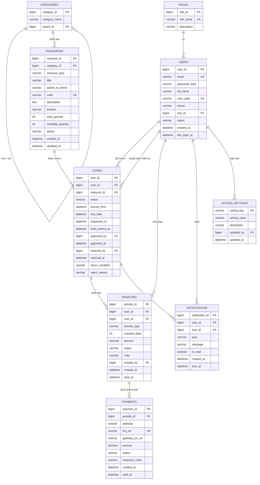

## Database (C3 - LAB7)

## Chương 3. Thiết kế cơ sở dữ liệu

### 3.1. Xác định các thực thể

Cơ sở dữ liệu quan hệ gồm 9 bảng, suy ra từ Use Case của Lab 2 và User Story của Lab 3.

| Bảng | Chức năng | Phục vụ |
| --- | --- | --- |
| roles | Danh mục vai trò: Sinh viên, Giảng viên, Thủ thư, Admin | UC01, UC03 |
| users | Tài khoản và thông tin người dùng | UC01, UC03 |
| categories | Danh mục phân loại tài nguyên, có thể lồng nhau | UC02, UC04 |
| resources | Sách, thiết bị, phòng học và số lượng tồn kho | UC02, UC04, UC05 |
| loans | Phiếu mượn: giữ chỗ, chờ duyệt, đang mượn, đã trả | UC06, UC07, UC08, UC09 |
| penalties | Phiếu phạt trả trễ, hư hỏng, mất | UC08, UC09 |
| payments | Giao dịch thanh toán tiền phạt qua VNPay, MoMo | UC10 |
| system_settings | Tham số: mượn tối đa, mức phạt mỗi ngày, thời gian giữ chỗ | US16 |
| notifications | Thông báo nhắc hạn trả | US09 |

### 3.2. Sơ đồ ERD

Hình 3.1. Sơ đồ ERD của hệ thống.

### 3.3. Mô tả các bảng dữ liệu

- **loans** là bảng trung tâm: một dòng là một lần đặt mượn một tài nguyên, đi qua các trạng thái HOLDING, PENDING, BORROWING, RETURNED, REJECTED, CANCELLED, EXPIRED. Sách thường mượn theo số ngày; phòng và thiết bị mượn theo khung giờ `borrow_from` đến `due_date`, nên cùng một bảng phục vụ cả lịch trống (UC05).
- **resources** giữ hai con số: `total_quantity` là số bản sở hữu, `available_quantity` là số bản còn cho mượn. Phòng học có `total_quantity` bằng 1.
- **penalties** gắn với một phiếu mượn; một phiếu có thể phát sinh nhiều phiếu phạt (vừa trả trễ vừa hư hỏng).
- **payments** ghi mỗi lần thử thanh toán, kể cả thất bại; một phiếu phạt chỉ có tối đa một giao dịch SUCCESS.
- **system_settings** lưu cặp khóa và giá trị, gồm `MAX_ACTIVE_LOANS`, `LOAN_DAYS`, `FINE_PER_DAY`, `HOLD_MINUTES`, `REMIND_BEFORE_DAYS`.

### 3.4. Data Dictionary

**Bảng roles**

| Thuộc tính | Kiểu dữ liệu | PK/FK | Ràng buộc | Ý nghĩa |
| --- | --- | --- | --- | --- |
| role_id | BIGINT | PK | AUTO_INCREMENT | Mã vai trò |
| role_name | VARCHAR(30) | | UNIQUE, NOT NULL | STUDENT, LECTURER, LIBRARIAN, ADMIN |
| description | VARCHAR(255) | | NULL | Mô tả vai trò |

**Bảng users**

| Thuộc tính | Kiểu dữ liệu | PK/FK | Ràng buộc | Ý nghĩa |
| --- | --- | --- | --- | --- |
| user_id | BIGINT | PK | AUTO_INCREMENT | Mã người dùng |
| email | VARCHAR(100) | | UNIQUE, NOT NULL | Email trường dùng để đăng nhập (BR08) |
| password_hash | VARCHAR(255) | | NOT NULL | Mật khẩu đã mã hóa Bcrypt |
| full_name | VARCHAR(100) | | NOT NULL | Họ và tên |
| user_code | VARCHAR(20) | | UNIQUE, NOT NULL | Mã sinh viên, giảng viên hoặc cán bộ |
| phone | VARCHAR(20) | | NULL | Số điện thoại |
| role_id | BIGINT | FK → roles | NOT NULL | Vai trò, quyết định quyền truy cập (BR07) |
| status | VARCHAR(20) | | NOT NULL, mặc định ACTIVE | ACTIVE hoặc LOCKED |
| created_at | DATETIME | | NOT NULL | Ngày tạo tài khoản |
| last_login_at | DATETIME | | NULL | Lần đăng nhập gần nhất |

**Bảng categories**

| Thuộc tính | Kiểu dữ liệu | PK/FK | Ràng buộc | Ý nghĩa |
| --- | --- | --- | --- | --- |
| category_id | BIGINT | PK | AUTO_INCREMENT | Mã danh mục |
| category_name | VARCHAR(100) | | NOT NULL | Tên danh mục |
| parent_id | BIGINT | FK → categories | NULL | Danh mục cha, NULL nếu là gốc |

**Bảng resources**

| Thuộc tính | Kiểu dữ liệu | PK/FK | Ràng buộc | Ý nghĩa |
| --- | --- | --- | --- | --- |
| resource_id | BIGINT | PK | AUTO_INCREMENT | Mã tài nguyên |
| category_id | BIGINT | FK → categories | NOT NULL | Danh mục |
| resource_type | VARCHAR(20) | | NOT NULL | BOOK, EQUIPMENT hoặc ROOM |
| title | VARCHAR(255) | | NOT NULL | Tên sách, thiết bị hoặc phòng |
| author_or_brand | VARCHAR(150) | | NULL | Tác giả hoặc hãng sản xuất |
| code | VARCHAR(50) | | UNIQUE, NOT NULL | ISBN, số serial hoặc mã phòng |
| description | TEXT | | NULL | Mô tả |
| location | VARCHAR(100) | | NULL | Vị trí kệ hoặc kho |
| total_quantity | INT | | NOT NULL, CHECK ≥ 0 | Tổng số bản sở hữu |
| available_quantity | INT | | NOT NULL, CHECK 0 ≤ giá trị ≤ total_quantity | Số bản còn cho mượn (đã trừ giữ chỗ) |
| status | VARCHAR(20) | | NOT NULL, mặc định ACTIVE | ACTIVE hoặc INACTIVE (xóa mềm) |
| created_at | DATETIME | | NOT NULL | Ngày tạo |
| updated_at | DATETIME | | NOT NULL | Ngày cập nhật cuối |

**Bảng loans**

| Thuộc tính | Kiểu dữ liệu | PK/FK | Ràng buộc | Ý nghĩa |
| --- | --- | --- | --- | --- |
| loan_id | BIGINT | PK | AUTO_INCREMENT | Mã phiếu mượn |
| user_id | BIGINT | FK → users | NOT NULL | Người mượn |
| resource_id | BIGINT | FK → resources | NOT NULL | Tài nguyên được mượn |
| status | VARCHAR(20) | | NOT NULL | HOLDING, PENDING, BORROWING, RETURNED, REJECTED, CANCELLED, EXPIRED |
| borrow_from | DATETIME | | NOT NULL | Thời điểm bắt đầu mượn |
| due_date | DATETIME | | NOT NULL, CHECK due_date > borrow_from | Hạn trả |
| requested_at | DATETIME | | NOT NULL | Thời điểm đặt |
| hold_expires_at | DATETIME | | NULL | Hết hạn giữ chỗ (requested_at + 10 phút), chỉ có khi HOLDING |
| approved_by | BIGINT | FK → users | NULL | Thủ thư duyệt hoặc từ chối |
| approved_at | DATETIME | | NULL | Thời điểm duyệt |
| received_by | BIGINT | FK → users | NULL | Thủ thư nhận trả |
| returned_at | DATETIME | | NULL | Thời điểm trả thực tế |
| return_condition | VARCHAR(20) | | NULL | GOOD, DAMAGED hoặc LOST |
| reject_reason | VARCHAR(255) | | NULL | Lý do từ chối |

**Bảng penalties**

| Thuộc tính | Kiểu dữ liệu | PK/FK | Ràng buộc | Ý nghĩa |
| --- | --- | --- | --- | --- |
| penalty_id | BIGINT | PK | AUTO_INCREMENT | Mã phiếu phạt |
| loan_id | BIGINT | FK → loans | NOT NULL | Phiếu mượn phát sinh vi phạm |
| user_id | BIGINT | FK → users | NOT NULL | Người bị phạt |
| penalty_type | VARCHAR(20) | | NOT NULL | OVERDUE, DAMAGED hoặc LOST |
| overdue_days | INT | | NULL, CHECK ≥ 0 | Số ngày trễ, chỉ dùng khi OVERDUE |
| amount | DECIMAL(12,0) | | NOT NULL, CHECK > 0 | Số tiền phạt (VND) |
| status | VARCHAR(20) | | NOT NULL, mặc định UNPAID | UNPAID hoặc PAID |
| note | VARCHAR(255) | | NULL | Ghi chú, mô tả hư hỏng |
| created_by | BIGINT | FK → users | NULL | Thủ thư lập phiếu; NULL nếu hệ thống tự tạo |
| created_at | DATETIME | | NOT NULL | Ngày lập |
| paid_at | DATETIME | | NULL | Ngày thanh toán xong |

**Bảng payments**

| Thuộc tính | Kiểu dữ liệu | PK/FK | Ràng buộc | Ý nghĩa |
| --- | --- | --- | --- | --- |
| payment_id | BIGINT | PK | AUTO_INCREMENT | Mã giao dịch nội bộ |
| penalty_id | BIGINT | FK → penalties | NOT NULL | Phiếu phạt được thanh toán |
| gateway | VARCHAR(20) | | NOT NULL | VNPAY hoặc MOMO |
| txn_ref | VARCHAR(64) | | UNIQUE, NOT NULL | Mã tham chiếu gửi sang cổng, chống xử lý trùng IPN |
| gateway_txn_no | VARCHAR(64) | | NULL | Mã giao dịch do cổng trả về |
| amount | DECIMAL(12,0) | | NOT NULL, CHECK > 0 | Số tiền thanh toán |
| status | VARCHAR(20) | | NOT NULL, mặc định PENDING | PENDING, SUCCESS hoặc FAILED |
| response_code | VARCHAR(20) | | NULL | Mã kết quả của cổng |
| created_at | DATETIME | | NOT NULL | Thời điểm tạo giao dịch |
| paid_at | DATETIME | | NULL | Thời điểm cổng xác nhận thành công |

**Bảng system_settings**

| Thuộc tính | Kiểu dữ liệu | PK/FK | Ràng buộc | Ý nghĩa |
| --- | --- | --- | --- | --- |
| setting_key | VARCHAR(50) | PK | NOT NULL | Tên tham số |
| setting_value | VARCHAR(100) | | NOT NULL | Giá trị |
| description | VARCHAR(255) | | NULL | Mô tả |
| updated_by | BIGINT | FK → users | NULL | Admin cập nhật |
| updated_at | DATETIME | | NOT NULL | Thời điểm cập nhật |

**Bảng notifications**

| Thuộc tính | Kiểu dữ liệu | PK/FK | Ràng buộc | Ý nghĩa |
| --- | --- | --- | --- | --- |
| notification_id | BIGINT | PK | AUTO_INCREMENT | Mã thông báo |
| user_id | BIGINT | FK → users | NOT NULL | Người nhận |
| loan_id | BIGINT | FK → loans | NULL | Phiếu mượn liên quan |
| type | VARCHAR(30) | | NOT NULL | Ví dụ DUE_REMINDER |
| message | VARCHAR(500) | | NOT NULL | Nội dung |
| is_read | BOOLEAN | | NOT NULL, mặc định FALSE | Đã đọc hay chưa |
| created_at | DATETIME | | NOT NULL | Thời điểm tạo |
| sent_at | DATETIME | | NULL | Thời điểm gửi email |

### 3.5. Khóa chính, khóa ngoại và ràng buộc dữ liệu

- Mọi bảng có khóa chính; riêng system_settings dùng `setting_key`.
- Khóa ngoại: users.role_id, categories.parent_id, resources.category_id, loans.user_id, loans.resource_id, loans.approved_by, loans.received_by, penalties.loan_id, penalties.user_id, penalties.created_by, payments.penalty_id, system_settings.updated_by, notifications.user_id, notifications.loan_id. Tất cả dùng ON DELETE RESTRICT để không mất lịch sử mượn trả; vì vậy tài nguyên và tài khoản bị khóa hoặc đặt INACTIVE thay vì xóa cứng.
- UNIQUE: users.email, users.user_code, roles.role_name, resources.code, payments.txn_ref.
- CHECK: `0 <= available_quantity <= total_quantity`; `due_date > borrow_from`; `amount > 0`.
- Chống mượn trùng (tương đương UNIQUE(student_id, section_id) ở đề mẫu): người dùng không được có hai phiếu HOLDING, PENDING hoặc BORROWING cho cùng một tài nguyên. MySQL không có UNIQUE theo điều kiện, nên Loan Service kiểm tra trong cùng transaction.
- Chống vượt tồn kho: ngoài CHECK, câu UPDATE trừ tồn kho có điều kiện `available_quantity > 0` (Hình 2.2 trong [architecture.md](architecture.md)).
- Chống trùng lịch phòng và thiết bị: trước khi tạo phiếu, Loan Service kiểm tra không có phiếu HOLDING, PENDING hoặc BORROWING nào giao khoảng `borrow_from` đến `due_date`.
- Chỉ mục: FULLTEXT trên resources(title, author_or_brand) cho tra cứu dưới 2 giây; loans(user_id, status); loans(status, hold_expires_at) cho Scheduler; loans(resource_id, borrow_from, due_date) cho lịch trống; penalties(user_id, status) cho kiểm tra BR01.

### 3.6. Quan hệ giữa các bảng

| Quan hệ | Bản số | Diễn giải |
| --- | --- | --- |
| roles – users | 1–N | Một vai trò có nhiều người dùng; mỗi người một vai trò. |
| categories – categories | 1–N | Danh mục cha chứa nhiều danh mục con. |
| categories – resources | 1–N | Một danh mục có nhiều tài nguyên. |
| users – loans | 1–N | Một người mượn nhiều lần; thủ thư xuất hiện ở approved_by và received_by. |
| resources – loans | 1–N | Một tài nguyên được mượn nhiều lần theo thời gian. Quan hệ N–N giữa users và resources được triển khai qua bảng loans, giống Enrollments ở đề mẫu. |
| loans – penalties | 1–N | Một phiếu mượn có thể có nhiều phiếu phạt. |
| users – penalties | 1–N | Một người có nhiều phiếu phạt. |
| penalties – payments | 1–N | Một phiếu phạt có thể thanh toán nhiều lần thử; chỉ một lần SUCCESS. |
| users – notifications | 1–N | Một người nhận nhiều thông báo. |

### 3.7. Đối chiếu ERD với Class Diagram Buổi 5

Sơ đồ lớp Buổi 5 chưa có trong tài liệu nhóm gửi kèm, nên bảng dưới đối chiếu với các lớp suy ra từ Lab 2 và Lab 3. Cần sửa lại nếu tên lớp ở Buổi 5 khác.

| Lớp (Class Diagram) | Bảng (ERD) | Ghi chú ánh xạ |
| --- | --- | --- |
| User, và các lớp con Student, Lecturer, Librarian, Admin | users, roles | Kế thừa chuyển thành một bảng users kèm role_id. |
| Resource, và các lớp con Book, Equipment, Room | resources | Một bảng, phân biệt bằng resource_type (Single Table Inheritance). |
| Category | categories | Quan hệ cha – con giữ bằng parent_id. |
| LoanTicket (phiếu mượn) | loans | Thuộc tính status ánh xạ vòng đời phiếu. |
| Penalty | penalties | Phương thức tính tiền phạt nằm ở Penalty Service, bảng chỉ lưu kết quả. |
| Payment | payments | Gắn với cổng thanh toán qua gateway và txn_ref. |
| SystemConfig | system_settings | Mỗi quy định là một dòng khóa – giá trị. |
| Notification | notifications | |

### 3.8. Giải thích các quyết định thiết kế

- **Một bảng resources cho sách, thiết bị và phòng:** ba loại dùng chung luồng tra cứu, mượn, trả; tách bảng sẽ nhân đôi API và báo cáo. Khác biệt nhỏ nằm ở resource_type và `location`.
- **Trừ tồn kho khi giữ chỗ, không trừ lần hai khi duyệt:** Lab 2 (UC06) trừ khi đặt, Lab 3 (UC2) nói trừ khi duyệt. Nhóm thống nhất trừ một lần lúc HOLDING; duyệt chỉ đổi trạng thái, từ chối hoặc hết hạn thì cộng lại. Làm vậy không bao giờ trừ hai lần cho một phiếu.
- **Xóa mềm cho resources và users:** US10 cho phép xóa, nhưng phiếu mượn và phiếu phạt cũ vẫn phải tham chiếu được.
- **Tách payments khỏi penalties:** giữ được lịch sử thanh toán thất bại và chống xử lý lặp IPN nhờ txn_ref UNIQUE.
- **Tham số vào system_settings:** Admin đổi mức phạt, số ngày mượn mà không cần sửa mã (BR04).
- **Tiền phạt dùng DECIMAL(12,0):** VND không có phần lẻ, tránh sai số của kiểu số thực.
