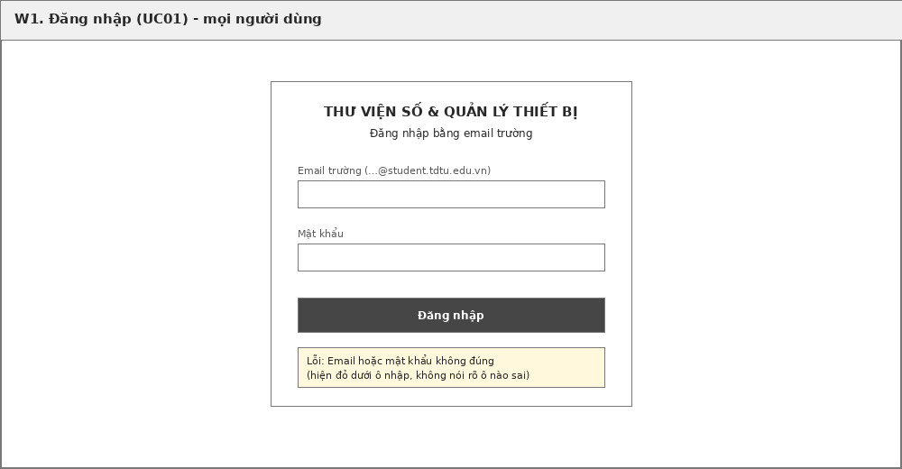
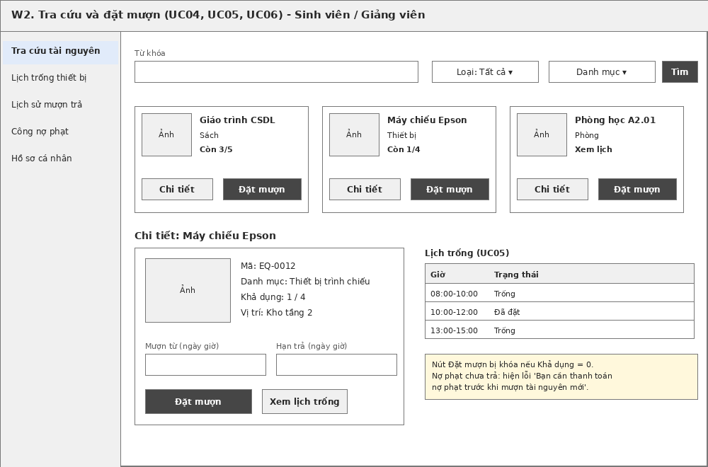
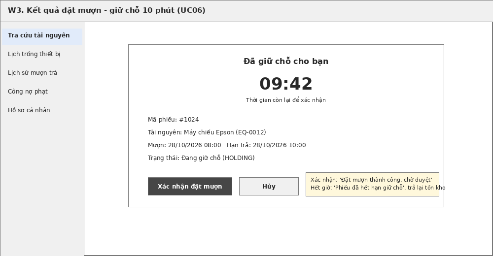
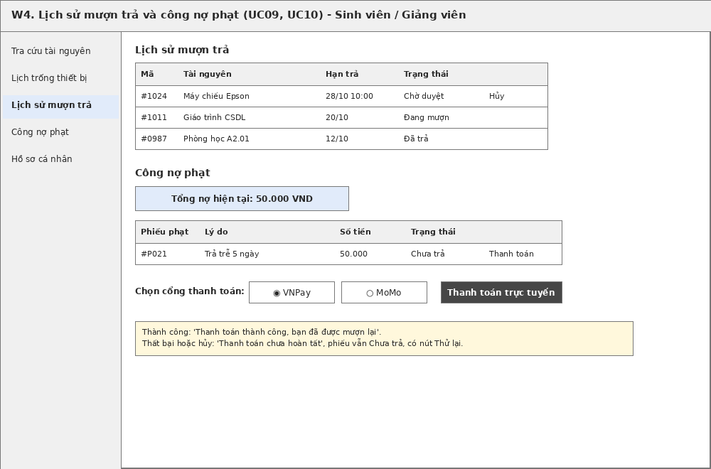
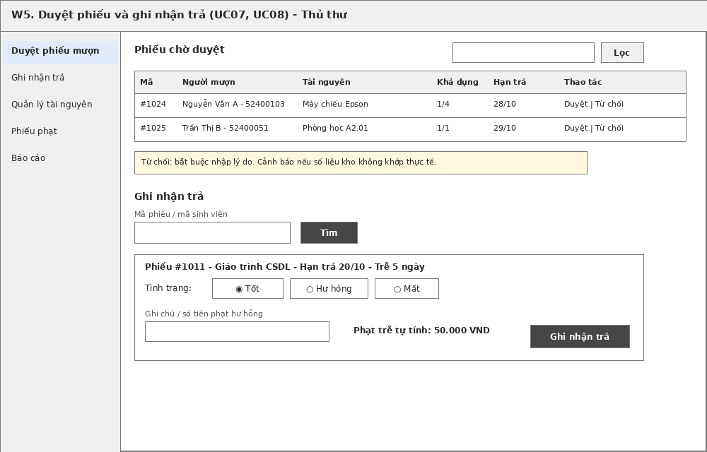
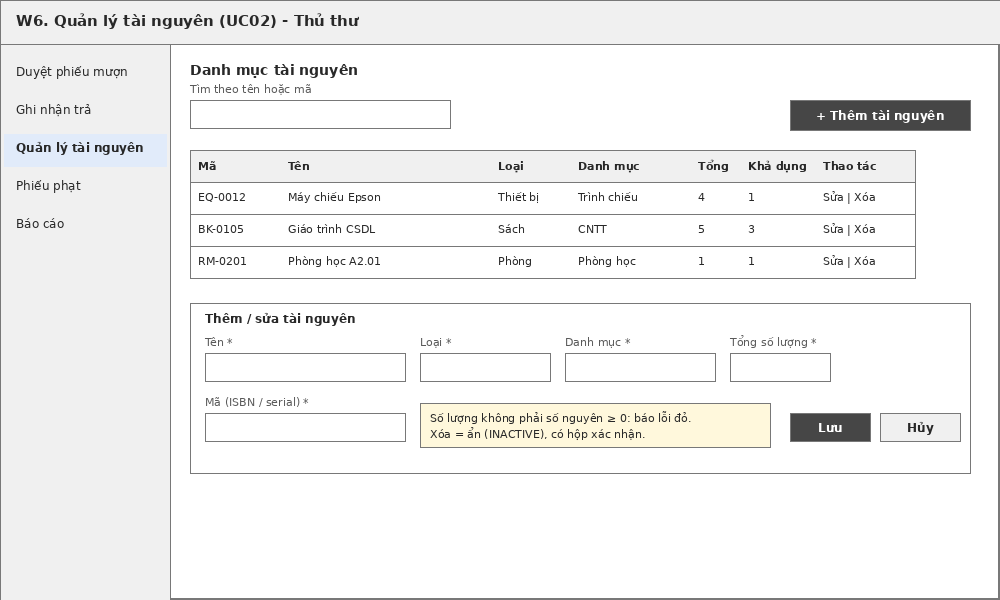
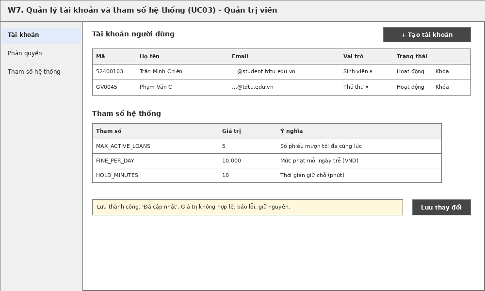

# Tài liệu Thiết kế Giao diện Người dùng (UI/UX)

## Chương 4. Thiết kế giao diện

Giao diện được xây dựng bằng **React + Tailwind CSS** theo chuẩn **Responsive Web Design** (tự động thu gọn thanh điều hướng bên trái thành Drawer Menu trên thiết bị di động). Để đảm bảo tính trực quan cho người dùng không chuyên kỹ thuật, mọi tài sản đều gắn **nhãn màu trạng thái thống nhất**:
- **Màu Xanh lá (`Available`):** Còn trống / Có thể đọc hoặc đặt mượn ngay.
- **Màu Đỏ (`Borrowed / Full`):** Đang được mượn hết hoặc khung giờ phòng đã kín.
- **Màu Xám (`Maintenance`):** Đang bảo trì hoặc ngừng lưu thông.

### 4.1. Danh sách màn hình và ánh xạ Phân hệ Chức năng

| Mã màn hình | Tên màn hình | Vai trò truy cập | Mã chức năng (`F`) đáp ứng |
| --- | --- | --- | --- |
| **W1** | Đăng nhập xác thực 2 bước bằng mã OTP | Tất cả người dùng | `F-11` |
| **W2** | Không gian Tra cứu, Đọc tài liệu số, Xem lịch trống & Đặt mượn / Đặt phòng | Sinh viên, Giảng viên | `F-01`, `F-02`, `F-03`, `F-07` |
| **W3** | Phiếu giữ chỗ 10 phút & Mã QR nhận tài sản | Sinh viên, Giảng viên | `F-03`, `F-04`, `F-07`, `F-08` |
| **W4** | Hồ sơ mượn trả cá nhân, Công nợ & Thanh toán VNPay/MoMo | Sinh viên, Giảng viên | `F-05`, `F-06`, `F-06b`, `F-08` |
| **W5** | Quầy Thủ thư: Quét QR Duyệt giao tài sản, Nhận trả & Lập phiếu phạt | Cán bộ Thư viện | `F-04`, `F-06` |
| **W6** | Quản lý Kho Tài liệu số, Thiết bị, Phòng học & Báo cáo thống kê | Cán bộ Thư viện | `F-01`, `F-09`, `F-10` |
| **W7** | Quản trị Tài khoản, Phân quyền, Tham số hệ thống & Nhật ký Audit Log | Quản trị viên | `F-09`, `F-11`, `F-12` |

---

### 4.2. Wireframe màn hình đăng nhập (`W1`)

### 4.3. Wireframe màn hình tra cứu, đọc tài liệu và đặt mượn (`W2`)

### 4.4. Wireframe màn hình giữ chỗ 10 phút và mã QR phiếu mượn (`W3`)

### 4.5. Wireframe màn hình lịch sử, công nợ phạt và thanh toán (`W4`)

### 4.6. Wireframe các màn hình nghiệp vụ quản lý và quản trị (`W5`, `W6`, `W7`)

---

### 4.7. Đặc tả thao tác, dữ liệu đầu vào và phản hồi hệ thống

| Màn hình | Dữ liệu người dùng nhập | Nút thao tác chính | Phản hồi khi hợp lệ (Thành công) | Phản hồi khi ngoại lệ (Thất bại) |
| --- | --- | --- | --- | --- |
| **W1** (`F-11`) | Bước 1: Email nhà trường. Bước 2: Mã OTP 6 chữ số nhận qua email. | `Nhận mã OTP`, `Xác nhận đăng nhập`, `Gửi lại mã (60s)` | Cấp Sanctum Bearer Token, điều hướng vào đúng Layout theo vai trò (`Sinh viên/Giảng viên`, `Thủ thư` hoặc `Admin`). | Báo lỗi nếu không phải email trường (`BR08`), tài khoản bị khóa, mã OTP hết hạn (quá 5 phút) hoặc nhập sai quá 5 lần. |
| **W2** (`F-01`, `F-02`, `F-03`, `F-07`) | Từ khóa, bộ lọc loại tài nguyên (`Tài liệu số`, `Sách`, `Thiết bị`, `Phòng học`); ngày mượn hoặc khung giờ đặt phòng; đề xuất bổ sung tài liệu (Giảng viên). | `Tìm kiếm`, `Đọc trực tuyến` (với tài liệu số), `Xem lịch tuần`, `Đặt mượn / Đặt phòng` | • `Tài liệu số`: Mở Modal trình đọc PDF tích hợp (`F-02`). • `Tài sản / Phòng`: Tạo giữ chỗ tạm thời và chuyển sang `W3` dưới 3 giây. | • Hết tồn kho / Trùng lịch phòng: Hiển thị cảnh báo đỏ. • Đang nợ phạt (`BR01`): Chặn thao tác và nhắc thanh toán tại `W4`. |
| **W3** (`F-03`, `F-04`, `F-08`) | Kiểm tra thông tin tài sản / khung giờ phòng trên màn hình đếm ngược 10 phút. | `Xác nhận đặt mượn`, `Hủy giữ chỗ` | Chuyển phiếu sang `PENDING`, gửi email xác nhận và sinh **Mã QR phiếu mượn** (`qr_token`) để xuất trình tại quầy thư viện. | Quá 10 phút chưa xác nhận: Hiển thị thông báo hết hạn giữ chỗ (`EXPIRED`), tự động hoàn lại số lượng khả dụng. |
| **W4** (`F-05`, `F-06`, `F-06b`, `F-08`) | Chọn phiếu cần hủy (trước hạn 2 giờ với phòng học); chọn cổng thanh toán (`VNPay` hoặc `MoMo`) cho phiếu phạt `UNPAID`. | `Hủy lịch đặt`, `Thanh toán trực tuyến` | • Hủy lịch: Mở lại slot trống ngay lập tức. • Thanh toán: Chuyển hướng sang Sandbox; khi IPN báo thành công thì gạch nợ về `0đ` và mở khóa quyền mượn (`BR06`). | Hủy phòng sát giờ (< 2 giờ) bị từ chối; giao dịch thanh toán bị hủy/lỗi giữ nguyên trạng thái `UNPAID` kèm nút `Thử lại`. |
| **W5** (`F-04`, `F-06`) | Quét mã QR phiếu mượn (hoặc nhập mã phiếu / MSSV); chọn tình trạng tài sản khi trả (`Tốt`, `Hư hỏng`, `Mất`); nhập lý do từ chối hoặc phí bồi thường. | `Quét QR / Tìm phiếu`, `Xác nhận giao đồ`, `Từ chối`, `Ghi nhận trả` | Cập nhật trạng thái `BORROWING` / `RETURNED` theo thời gian thực, cộng trả tồn kho; tự động sinh phiếu phạt nếu trả trễ hạn (`F-06`). | Từ chối không nhập lý do thì chặn lưu; cảnh báo nếu thiết bị đang ở trạng thái bảo trì; ghi toàn bộ thao tác vào `audit_logs`. |
| **W6** (`F-01`, `F-09`, `F-10`) | Thông tin tài nguyên (Tên, ISBN/Mã, Loại, Tổng số lượng, File PDF/EPUB); bộ lọc kỳ báo cáo theo tháng/loại tài nguyên. | `Thêm mới`, `Cập nhật`, `Chuyển bảo trì / Ẩn`, `Xuất Excel`, `Xuất PDF` | Kiểm tra trùng ISBN/Mã, lưu danh mục mới; hiển thị biểu đồ thống kê thời gian thực và tải xuống tệp báo cáo `.xlsx` / `.pdf`. | Báo lỗi ngay dưới ô nhập nếu mã tài sản bị trùng hoặc số lượng âm; không cho xóa cứng tài sản đã có lịch sử mượn. |
| **W7** (`F-11`, `F-12`) | Thông tin tài khoản, vai trò RBAC (`STUDENT`, `LECTURER`, `LIBRARIAN`, `ADMIN`); các tham số hệ thống (`FINE_PER_DAY`, `MAX_ACTIVE_LOANS`...); bộ lọc tra cứu nhật ký. | `Cấp quyền`, `Khóa/Mở tài khoản`, `Lưu cấu hình`, `Lọc Audit Log` | Áp dụng ngay quy định mới mà không cần khởi động lại server; hiển thị chi tiết nhật ký kiểm toán (Ai làm gì, lúc nào, IP nào). | Giá trị tham số sai định dạng (số âm, chữ) bị chặn và giữ nguyên cấu hình an toàn trước đó. |
